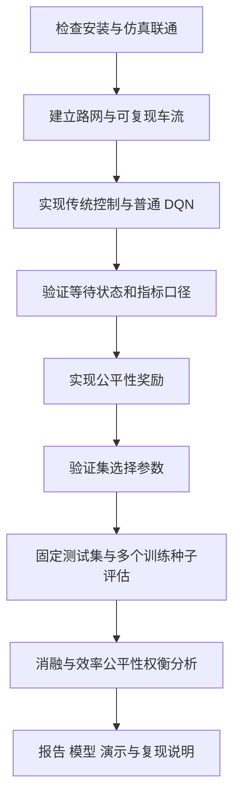

# Fair Signal

**兼顾通行效率与等待公平性的单路口深度强化学习信号控制。**

面向深度强化学习课程的可复现实验项目。使用 SUMO 仿真一个十字路口，研究在
方向不均衡、车流随时间变化时，DQN 能否减少整体排队，同时改善少数车辆的长时间等待。

本仓库独立位于 `code/`，仅使用本地 Git，目前没有远程仓库。
本项目原创代码采用 [MIT License](LICENSE)，依赖与第三方资料保留各自许可证。

## 当前状态

当前为**项目准备阶段**：包含实验方案、Python 依赖锁定、环境检查和联通测试入口。
正式车流生成、基线控制器、公平性状态/奖励、训练与统计分析尚未实现。
环境联通检查的短训练只验证工具链，不构成算法有效性证据。
实际安装和检查结果见 [环境记录](docs/environment.md)。

## 研究问题

在东西方向车流持续较大、南北方向车流较少时，单纯优化总排队可能使少量车辆等待过久。
本项目考察：增加等待状态和超时惩罚，是否能在较小效率代价下减少极端等待？

这是对已有公平交通控制思想的课程实现与实验研究，不宣称提出全新算法。
不会预先保证 DQN 优于调节合理的传统控制，也不会把奖励阈值解释为车辆通行时间保证。

## 项目范围

| 内容 | 首版设定 |
| --- | --- |
| 环境 | 一个四进口路口、普通机动车、单智能体 |
| 输入 | 数值交通状态，不加入视觉识别 |
| 动作 | 选择预定义合法绿灯相位 |
| 控制周期 | 初定 5 秒；切换时遵守黄灯及绿灯时长规则 |
| 算法 | CPU 上训练的小型 DQN，经验回放和目标网络 |
| 改进点 | 等待信息增强、超时等待惩罚、效率与公平性的权衡 |
| 首版边界 | 不加入多路口、行人、公交优先或真实道路部署 |

## 预期实验

| 控制方法 | 比较目的 |
| --- | --- |
| 调节后的固定配时 | 静态基线 |
| 感应式控制 | 根据当前需求调整的传统基线 |
| 加入等待老化规则的传统控制 | 检查简单防饥饿规则是否足够 |
| 普通 DQN | 学习方法基线 |
| 增加等待状态的 DQN | 分离状态信息的作用 |
| 增加等待状态和公平奖励的 DQN | 分离公平目标的作用 |

三类车流：均衡、方向不均衡、时变高峰。训练/验证/测试种子分离，同一测试车流供所有方法使用。
初定每种学习配置训练 3 个随机种子，每次 30 万决策步，先做短跑再调整预算。
公平性权重用验证集选择，测试集只作最终评估。

主要指标：车辆平均等待、P95 等待、平均行程时间、平均队列、通行数、未完成/未插入车辆数、
相位切换数与各方向等待。用原始交通指标评价，不能跨奖励定义比较累计奖励。
完整定义、风险和消融设计见 [实验方案](docs/experiment-plan.md)。

## 流程



## 环境要求

- macOS Apple Silicon（本机为 M3 Pro）或具有 SUMO 的其他平台。
- [uv](https://docs.astral.sh/uv/)；已有 uv 可直接复用。
- Python 3.12；由 uv 放入项目 `.runtime/python/`，无需更改系统 Python。
- 全局 SUMO 1.28.0；Python 端的 TraCI/sumolib 固定为对应版本。
- macOS 原生 GUI 使用 XQuartz；无界面训练无需启动 XQuartz 会话。

系统安装与清理见 [安装说明](docs/setup.md) 和 [清理说明](docs/cleanup.md)。

## 快速开始

以下命令在本仓库根目录（`code/`）执行。首次安装需要网络。

```bash
# 全局 SUMO 安装完成后，建立项目环境并检查
bash scripts/setup.sh

# 查看 Python 包版本与 SUMO 路径
bash scripts/run.sh fair-signal doctor

# 执行有限步数的仿真、DQN 更新与模型保存/加载检查
bash scripts/run.sh fair-signal smoke --steps 128

# 代码检查
bash scripts/run.sh ruff check .
bash scripts/run.sh pytest
```

`scripts/run.sh` 会设置项目缓存目录和 SUMO 路径，不修改全局 shell 配置。
如果 SUMO 装在其他位置，用 `SUMO_HOME=/实际路径 bash scripts/run.sh ...` 覆盖。
直接使用 `uv run` 时，应先在 Bash 中 `source scripts/env.sh`。

联通测试会读取 SUMO-RL 自带路网，并在 `outputs/smoke/` 生成临时车流、模型与检查报告。
这些文件不进入 Git。训练、批量评估和绘图命令将在相应功能完成后补充。

## 仓库结构

```text
code/
├── src/fair_signal/       # Python 包与命令行入口
├── scripts/              # 环境设置和运行脚本
├── configs/              # 实验规划与后续运行配置
├── data/                 # 场景说明；生成数据不入库
├── tests/                # 关键行为检查
├── docs/                 # 实验、环境、安装与清理文档
├── outputs/              # 日志、模型和图表（Git 忽略）
├── .venv/                # 独立 Python 环境（Git 忽略）
├── .runtime/             # 项目 Python（Git 忽略）
├── .cache/               # 安装包和工具缓存（Git 忽略）
├── pyproject.toml
├── uv.lock               # 精确依赖版本
├── README.md
└── LICENSE
```

## 最终成果与里程碑

1. **环境准备**：本地仓库、依赖锁定、SUMO 联通、安装与清理记录。
2. **基础实验**：可复现车流、传统基线、普通 DQN 和统一指标。
3. **公平性实验**：增强状态、奖励、消融和公平性权重扫描。
4. **最终交付**：问题与算法设计、流程图、源码、执行入口、已训练模型、部署说明、
   多种子结果表、效率公平性图、失败案例与 GUI 演示。

本项目的“执行程序”预期为命令行入口与模型加载程序；独立打包的应用程序不在当前首版范围。
正式结果、复现命令与模型校验值在实验完成后发布到文档中。

## 开发与贡献

参见 [CONTRIBUTING.md](CONTRIBUTING.md)。使用 `src/` 布局、Ruff 和 pytest。
在 VS Code 中打开本仓库，选择 `.venv/bin/python` 即可。当前没有远程 CI 或 GitHub Actions。

变更记录见 [CHANGELOG.md](CHANGELOG.md)，引用与依赖许可证见
[THIRD_PARTY_NOTICES.md](THIRD_PARTY_NOTICES.md)。

## 参考资料

- [SUMO](https://eclipse.dev/sumo/)：交通微观仿真。
- [SUMO-RL](https://github.com/LucasAlegre/sumo-rl)：Gymnasium 接口与单路口示例。
- [Stable-Baselines3 DQN](https://stable-baselines3.readthedocs.io/en/master/modules/dqn.html)：标准 DQN 实现。
- [A Deep Reinforcement Learning Approach for Fair Traffic Signal Control](https://arxiv.org/abs/2107.10146)：公平性研究背景。
