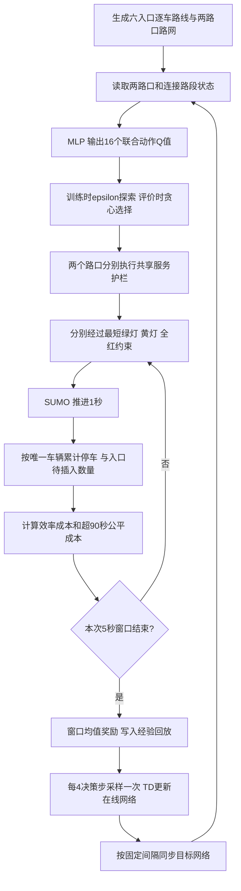

# 两路口实现与算法流程

本模块独立于历史单路口代码，未新增 Python 依赖。它仍使用原生 SUMO、TraCI、
Gymnasium 与 Stable-Baselines3 DQN，在现有 uv 环境中运行。
实验设计、参数与局限见 [方案](arterial-plan.md)，命令见 [运行说明](running.md)。

## 模块

| 文件 | 职责 |
| --- | --- |
| `src/fair_signal/arterial/demand.py` | 原创路网、显式信号连接索引、跨路口路线、逐车随机到达与清单校验 |
| `src/fair_signal/arterial/environment.py` | 152维观测、16联合动作、统一护栏、逐秒仿真、全网唯一车辆记账 |
| `src/fair_signal/arterial/controllers.py` | 协调固定配时、感应式、aging、上下游 Max-Pressure 变体 |
| `src/fair_signal/arterial/policies.py` | 限制本地信息访问的可加 Q 网络 |
| `src/fair_signal/arterial/validation.py` | 独立审计逐秒信号区间及模式转换 |
| `scripts/arterial_study.py` | 冻结配置、调参、训练、开发验证和产物复用检查 |
| `scripts/summarize_arterial.py` | 完整矩阵、身份与日志审计，模型种子统计、配对差值与静态图 |
| `scripts/view_arterial.py` | 已有验证车流的 GUI/无界面精确回放 |
| `scripts/diagnose_arterial.py` | 保持控制不变，读取末端车辆和绿灯需求，诊断清空失败 |

全部运行产物写入 `outputs/`，小型 CSV/JSON/图片报告写入 `docs/results/`。
模型、训练日志、路线和逐秒轨迹不提交 Git。实验代码摘要包含本模块、实际复用的基础代码、
实验脚本及锁文件；增加子包不改变历史单路口实验代码摘要，历史数据仍保留原身份。
修改代码或配置后不得复用旧结果目录。

## 联合动作与学习

联合动作 `a = 4*phase_A + phase_B`，取值 0–15。物理层分别处理两个路口的请求，
正在黄灯/全红或未达到最短绿灯的请求不会绕过约束。

联合 DQN 用全网观测输出 16 个 Q 值，选择最大者。公平联合 DQN 保持同一网络与观测，
只改变奖励。两者均使用 SB3 原版 DQN，未改称 Double DQN、QMIX 或其他算法。

本地可加 Q 消融满足 `Q(o_A,o_B,a_A,a_B) = Q_A(o_A,a_A) + Q_B(o_B,a_B)`，
因此贪心决策等价于两个本地分支各取最大值。训练仍使用全网奖励和联合经验回放，
这是价值函数结构消融，并不是两个独立训练的多智能体系统。

TD 目标为标准 DQN 的 `r + gamma * max_a Q_target(next_state,a)`，真正终止时去掉
后续价值项；时间上限截断沿用 SB3 的处理。一个决策步最多推进5秒，折扣按决策步计算。
所有方法使用相同车流窗口和清空上限；到达清空上限仍未完成的评价回合不能参与性能排名。

## 记账与公平成本

车辆可能在两个路口、连接路段、出口和内部路段停车，在线字典按 SUMO 车辆 ID 维护
全程累计停车时间。队列奖励按当前确实累计了一秒等待的唯一车辆数计算，不把连接路段
同时作为 A 出口和 B 入口重复计数。到时但未插入车辆另计效率成本。

SUMO 刚插入的车辆有时速度已很低，但尚未经历一秒等待，因此不能仅用瞬时速度增计。
实现订阅连续等待时钟 `VAR_WAITING_TIME`，以其是否为正判断本秒等待，自己保存跨次停车的
全程总量；不使用 SUMO 有限记忆的累计等待接口。每个评价及完整训练回合结束后，
逐车核对本地总量与独立 TripInfo `waitingTime`，不一致立即停止。

公平成本是全程累计超90秒等待的逐秒增量，车辆过第一个路口时不会清零。
记录 `traffic/queue_cost`、`traffic/fair_cost`、`traffic/guard_overrides`、行程指标和训练 loss
到 TensorBoard；短程训练结束也显式刷新日志。

## 评价边界

本轮是合成两路口路网的开发验证，并非真实道路部署。传统参数在单独调参车流中选择，
学习预算、权重和训练种子预先固定；开发验证不重选模型。所有方法使用相同服务护栏，
因此不能把结果当作纯 DQN 的效果。
本地可加 Q 和联合 Q 还存在结构、参数量差异，不支持单一因素的严格因果结论。
入口分类的支路车辆可能随后驶入干道，报告的干道/支路等待按车辆出生入口分组。
