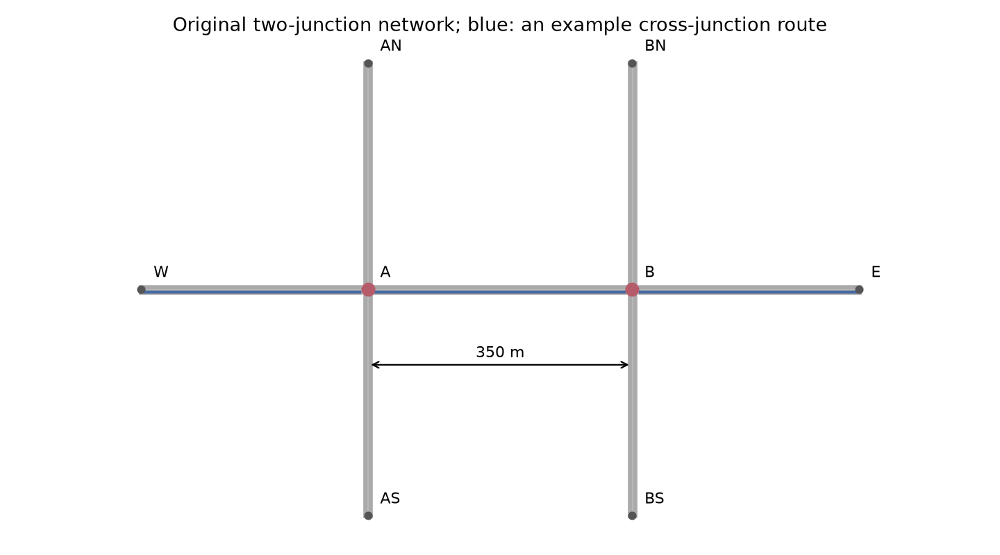
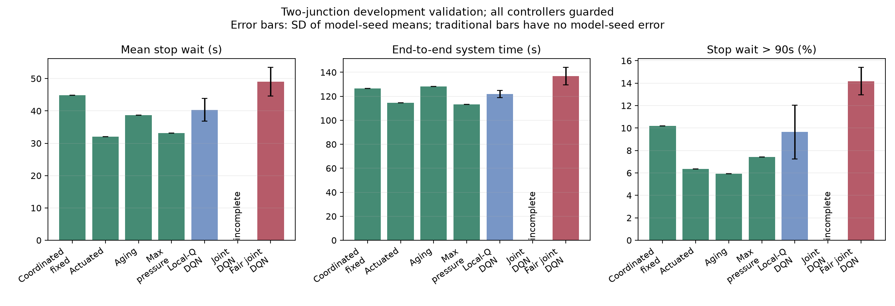
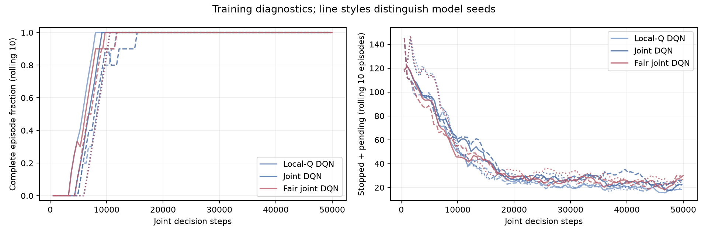

# 两路口协同控制：首轮开发验证结果

本轮完成了两路口路网、强传统基线和三种 DQN 的完整实验。结果**没有支持直接扩大路网就能让
联合 DQN 占优**：感应式的平均停车等待最低，压力控制的含插入延迟行程时间最低；
本地可加 Q 优于联合模型，但仍未胜过这两个强基线。公平联合 DQN 没有取得稳定的公平收益。

普通联合 DQN 的一个回合在清空上限后仍剩 5 辆车，整体性能不排名。
这不是最终盲测，也不是对所有多路口强化学习算法的结论。

## 实验与质量

- 两个四岔路口，间距 350 米；车辆沿真实连接路段连续行驶。
- 三种车流：稳定干道、潮汐变化、下游短时减速；每回合 1800 秒需求＋最多 900 秒清空。
- 4 种传统方法在独立调参车流上选择参数，共 72 回合，全部完成。
- 3 种学习配置，每种 3 个种子、每模型 50000 联合决策步：9 模型、450000 步、110250 次梯度更新。
- 开发验证为 195 回合，194 个完整；无未插入、碰撞或传送，只有上述回合的 5 辆车仍在路网内。
- 审计全部 267 条调参/验证轨迹、173002 个完整信号区间，含最终未结束区间的计时上限检查。
  逐秒全网停车积分与逐车 TripInfo 一致；入口积压及护栏接管计数可从轨迹重建。
- 模型实际更新、保存/重载检查通过，9 个 TensorBoard 日志中的 loss 与其他标量均有限。
- Mac 上三进程 CPU 运行，完整流水线墙钟 **1359.33 秒，约 22.66 分钟**，没有新增依赖。
- 33 项常规测试及 2 项两路口 SUMO 集成测试通过；后者包含完整车流低速插入记账回归。

训练核心版本为 `f91833a`，核心代码摘要为
`6f1b6809541b465761a26874f3284cae392ce262cf1060062bdff4a07af3e17c`。
历史单路口核心摘要保持不变，既有模型和结果未覆盖。
预留两路口测试种子 4001–4010 未生成或评估，历史单路口最终测试也未使用。
短程联通与失败案例回放另计，不当作新的独立验证样本。



所有方法在训练与评价时都使用同一服务请求护栏，学习方法均属于混合控制。
本地 Q 各分支只读对应路口状态，使用全网奖励和联合回放，不是独立多智能体 DQN。
本地模型有 53768 参数，两个联合模型各 38160 参数；结构与容量的差异不能忽略。
完整预定设置见[方案](arterial-plan.md)，算法及模块见[实现](arterial-implementation.md)。

## 整体结果

各指标先按回合计算，再等权平均车流/场景和模型种子。P95 是回合 P95 的均值，
不是把所有车辆混合计算一个 P95。`±` 为 3 个训练种子均值的样本标准差，
传统方法没有模型种子标准差，不代表没有车流波动。不声称统计显著。
停车等待和超90秒指标不含入口插入延迟；完整行程列包含插入延迟，防止隐藏入口等待。

| 方法（均有护栏） | 完整回合 | 平均等待(s) ↓ | 回合P95(s) ↓ | 超90秒比例 ↓ | 完整行程(s) ↓ | 停车次数 ↓ |
| --- | --- | --- | --- | --- | --- | --- |
| 协调固定配时 | 15/15 | 44.88 | 112.17 | 10.20% | 126.68 | **1.483** |
| Actuated | 15/15 | **32.08** | 96.24 | 6.37% | 114.42 | 1.749 |
| Aging | 15/15 | 38.64 | **95.62** | **5.94%** | 128.05 | 2.365 |
| Max-Pressure 变体 | 15/15 | 33.21 | 102.48 | 7.42% | **113.09** | 1.511 |
| 本地可加 Q DQN | 45/45 | 40.32±3.52 | 125.00±7.19 | 9.65%±2.39% | 121.89±3.04 | 1.606 |
| 联合 DQN | 44/45 | 不排名 | 不排名 | 不排名 | 不排名 | 不排名 |
| 公平联合 DQN | 45/45 | 49.05±4.44 | 140.03±7.76 | 14.18%±1.23% | 136.88±7.27 | 2.142 |

本地 Q 相对协调固定配时平均等待减少 10.16%，完整行程缩短 3.78%，但停车次数增加；
相对 actuated 平均等待反而增加 25.68%，完整行程增加 6.53%。
压力控制相对 actuated 平均等待增加 3.50%，但完整行程减少 1.16%、停车次数减少 13.57%。
不同指标存在取舍，不能只用“哪个方法第一”概括。



## 分场景与连续通过车辆

| 场景 | Actuated 平均等待(s) | Max-Pressure(s) | 本地 Q(s) | 联合 Q(s) | 公平联合 Q(s) |
| --- | --- | --- | --- | --- | --- |
| 稳定干道 | 21.71 | 24.52 | 30.29 | 34.65 | 35.44 |
| 潮汐变化 | 26.12 | 26.58 | 36.07 | 41.27 | 41.25 |
| 下游减速 | 48.42 | 48.53 | 54.60 | 不排名 | 70.45 |

公平与普通联合模型只改变奖励，但普通模型的减速场景不完整，**不能用全局删失均值声称
公平奖励带来多少改善**。在完整的潮汐场景中，公平模型 P95 从 117.58 降至 109.32 秒，
同时超90秒比例从 8.76% 升至 9.62%；稳定场景主要等待指标略差，未形成一致收益。

以下按预生成路线筛选确实经过两个路口的车辆，不是仅按“干道入口”代替：

| 方法 | 连续通过车辆平均等待(s) ↓ | 完整行程(s) ↓ | 停车次数 ↓ |
| --- | --- | --- | --- |
| 协调固定配时 | 50.13 | 152.87 | 1.929 |
| Actuated | 32.91 | 135.52 | 2.191 |
| Max-Pressure | 33.65 | 132.98 | **1.902** |
| 本地 Q | 42.85 | 145.03 | 2.064 |
| 公平联合 Q | 53.74 | 165.32 | 2.856 |

本地 Q 比 actuated 的连续通过车辆少停约 5.80%，但等待和行程都更长；
不能把“少停车”单独当作协同控制成功。当前强传统方法已能处理相当一部分路口耦合。
上下游减速确实造成了压力，但本轮没有形成学习方法胜出的证据。

## 唯一不完整回合的精确诊断

案例：联合 DQN，训练种子 33，`downstream_slowdown/2003`。
冻结模型回放完全复现原指标，控制、护栏、路线和 2700 秒终止上限均未改变。
停止前读取实际车辆位置、下一信号、可继续车道和所需相位，诊断小型产物见
[末端车辆](results/arterial-50k/diagnostic-joint_dqn-33-downstream_slowdown-2003/terminal_snapshot.json)
和[相位分配](results/arterial-50k/diagnostic-joint_dqn-33-downstream_slowdown-2003/phase_allocation.csv)。

5 辆车全部在 `b_a_0`，由 B 驶向 A，继续向西直行，所需为 **A 的相位2**。
其路线可继续，末端路网中没有其他车辆形成下游满载阻塞；累计停车为 561–618 秒。

| 最后300秒：A路口 | 所需相位2（东西直右） | 相位3（东西左转） |
| --- | --- | --- |
| 模型原始请求次数 | **0** | **60** |
| 护栏处理后请求次数 | 2 | 58 |
| 实际绿灯秒数 | **22** | **202** |
| 其中绿灯前后均无对应进口车辆的秒数 | 0 | **182** |

护栏提供了两次相位2绿灯机会，各11秒，车辆开始移动后部分又遇到红灯；
例如最后一次绿灯为 2640–2650 秒，2700 秒仍剩5辆。
主要问题是**服务时间不足、过多绿灯分给没有对应需求的相位**；所需相位也曾获得绿灯。
护栏在获得绿灯时就重置请求年龄，并不保证足够车辆已经通过；末端该车道请求年龄为50秒，
尚未达到180秒接管阈值。由此再次说明服务请求阈值不是车辆等待或清空时间的保证。

没有延长清空上限，没有删除这一个失败回合，也没有把回放当作修复后的新成绩。

## 结果含义与下一步

训练曲线显示，三种模型都从高积压、较多截断改善到训练末段大多完成清空，
但训练成功不等于在验证车流上可靠或优于基线。



已确认的事实是：在本轮固定预算、状态、奖励与路网上，直接联合输出16个相位组合没有
取得优势，本地可加 Q 在两个完整场景中平均等待更低，传统控制仍很强。
联合价值函数更难学习、动作组合稀疏、稀有尾段泛化不足都是可能解释；
本轮没有分别控制这些因素，不能把其中某一个写成已经证实的唯一原因。

下一轮优先保持两路口规模，考虑需求约束/服务保持，或者在压力控制或感应式基础上
学习有限修正；任何共享护栏修改都应对所有方法统一应用，并单独命名混合控制结果。
若继续研究邻路口信息的价值，还需要匹配容量、分离观测与可加结构的消融。
这些均为尚未实现的后续方案，不属于本轮成绩。

## 复现与产物

```bash
bash scripts/run.sh python scripts/arterial_study.py --workers 3
bash scripts/run.sh python scripts/summarize_arterial.py
bash scripts/run.sh tensorboard --logdir outputs/arterial-50k/models --host 127.0.0.1
bash scripts/run.sh python scripts/view_arterial.py --method local_dqn --scenario tidal --delay 100
# 精确复现失败回合并导出末端快照，不改变控制
bash scripts/run.sh python scripts/diagnose_arterial.py
```

GUI 默认暂停，点 Play 开始，Stop/Single Step 和 Delay 控制观看节奏。
模型、路线、TensorBoard、逐秒轨迹和完整 TripInfo 位于 `outputs/arterial-50k/`，不提交 Git。
小型公开报告位于 `docs/results/arterial-50k/`：
[质量门](results/arterial-50k/quality.json)、[冻结配置](results/arterial-50k/study.json)、
[整体/场景汇总](results/arterial-50k/summary.csv)、[各模型种子](results/arterial-50k/per_seed.csv)、
[配对差值](results/arterial-50k/paired_differences.csv)、[全部验证](results/arterial-50k/validation.csv)。
