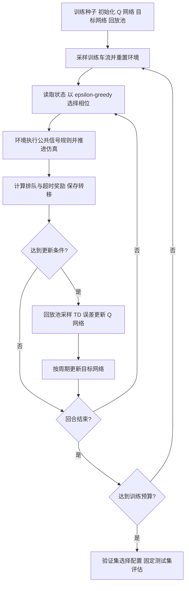

# 实验方案

状态：首版已实现，正在执行小规模验证；正式多种子实验尚未执行。
本页保留研究设计，具体已实现参数、状态维度、计时和指标口径见
[实现说明](implementation.md)，执行命令见 [运行指南](running.md)。

## 目标与假设

主问题：在方向不均衡和时变车流下，等待信息与公平性惩罚是否能改善极端等待，
且整体效率代价可接受？

- H1：等待状态增强能让策略识别长期未被服务的方向。
- H2：超时惩罚可降低 P95 等待或超时比例，可能增加平均等待或切换次数。
- H3：与简单防饥饿规则相比，学习策略的优势可能依赖车流变化程度。

允许不支持假设或部分支持假设的结果。报告应包含均衡场景中传统控制表现较好的案例。

## MDP 与约束

基础状态包含当前相位、绿灯持续时间/最小绿灯标记、车道密度与队列。
增强状态增加各进口车道队首车辆等待，以及有请求但未获绿灯机会的时间。
首版细分为 8 个车道特征，以区分直行与左转需求；无车辆的请求年龄设为零。
累计等待跟随车辆，换车道后归入当前车道；具体定义见实现说明。
局部观测是控制所用状态近似，不宣称完全满足真实交通的马尔可夫性。

动作选择固定的合法绿灯相位，选择当前相位表示保持。环境执行黄灯、最小绿灯、
最大连续绿灯等公共规则，所有控制器使用一致的切换损失和基础约束。
最大绿灯不自动等价于“每个方向必然获得服务”；需要单独检查是否存在方向饥饿。
已检查 SUMO-RL 1.4.5 源码：`max_green` 参数目前不执行上限约束。
正式实验必须显式实现并测试公共约束层，不能仅传参后假定生效。
若增加强制防饥饿干预，应记录干预次数并作为独立实验因素，不把其收益归于奖励设计。

奖励候选：`r = -Q_normalized - lambda * H_normalized`。
Q 为总排队车辆数；H 为各进口车道停车队首超过阈值后的等待程度之和。
归一化常数从设计上固定或仅由训练集确定，不能利用测试集。
初定阈值 90 秒，仅是实验设计参数，不是交通规范或服务承诺。
奖励和状态计时只使用当前及历史观测，不读取未来到达信息。

## 车流与数据划分

固定同一单路口网络和车辆参数，设置三类需求：

1. 均衡：各方向到达率接近。
2. 方向不均衡：主方向持续较大、次方向有稀疏请求。
3. 时变高峰：各时间段的总需求与主方向变化。

先核查路口容量，主实验避免所有控制器都无法处理的持续过饱和。
过饱和可作为压力测试单独报告，不能通过删除拥堵车辆制造改善。
训练在分布内随机生成车流；验证和测试保存独立的固定路线文件与种子。
除新的到达随机数外，还要在测试中保留未训练的需求参数组合，以检查泛化。

初定需求注入 3600 秒；注入结束后继续控制、清空路网，设置独立超时上限。
环境终止方式需要显式实现，不能直接把首个 3600 秒终点当成所有车辆已完成。

## 实验矩阵与预算

核心学习方法：基础 DQN、等待状态 DQN、公平奖励 DQN。
传统方法：验证集调节的固定配时、感应式、带等待老化规则的传统控制。
固定配时/感应式参数只使用训练或验证数据选择。
所有方法使用相同路网、车辆、基础信号规则和测试到达序列。

初定每个学习方法 3 个训练种子、每次 30 万决策步，网络为两层 128 单元。
训练用混合车流分布，测试分别按车流类型报告，避免每种测试车流都单独训练一次。
先运行约 1 万决策步估算端到端速度，再确定正式预算。
公平权重先做小预算验证扫描，然后固定所选配置进行完整多种子训练。
如绘制多个权重的正式权衡曲线，应使用相同训练预算，并说明每个点的训练种子数。
首轮短跑已使用 2001/2002 测试种子；后续这些结果只能作为开发资料。
正式配置预留新的 3001–3010 测试种子，避免把已经看过的短跑测试当作最终盲测。

首版不引入 Double DQN、GNN、LLM 或扩散模型。
噪声/缺失观测作为可选扩展，不应挤占核心消融的预算。

## 评价与统计

车辆指标采用全程累计停车等待（具体使用 SUMO 的全程输出字段），
不能直接用默认有限记忆窗口的 accumulatedWaitingTime 充当全程等待。
P95 以车辆为样本计算，并按训练种子与测试车流保留层次。
至少同时报告：

- 平均/P95 等待、超过阈值比例、各进口方向的等待；
- 平均行程时间、通行数、平均与峰值队列、相位切换数；
- 未完成行程、尚未成功插入、传送/异常移除车辆数及清空超时情况。

需求注入窗口的队列指标与清空阶段指标分开，防止可变清空时长影响平均口径。
只报告已完成车辆的等待会产生选择偏差，因此须同时报告删失数量和当前等待。
同一测试路线文件进行成对比较；独立训练种子是模型重复，不把逐车辆样本当作独立训练重复。
先报告每个训练种子的测试均值，再汇总均值/标准差；3 个种子不足以支持强统计结论。
不把不同奖励定义下的训练回报直接作算法优劣比较。

消融必须保留普通 DQN、仅增强状态、增强状态加奖励三组。
可视化包括学习曲线、平均等待与 P95 权衡、各方向等待、代表性相位/队列时间序列。
Q 值展示用于检查策略，不宣称是因果解释。

## 算法流程

标准 DQN 的目标是 `y = r + gamma * (1 - terminated) * max_a Q_target(s_next, a)`。
时间上限 truncated 与真正 terminal 必须区分；是否对回合截断 bootstrap 应依据回合定义。
Stable-Baselines3 的标准实现不自动包含 Double DQN。

## 最终交付

问题背景与研究假设；总体/算法设计和流程图；完整源程序；执行入口与模型；
跨机器运行说明；可复现配置与数据种子；多种子指标表、图表和原始结果；
局限与失败案例；GUI 演示；依赖、资料来源和卸载清单。

首版已交付可运行源码、执行入口和完整统计流程；小规模模型/结果在本机 outputs 下。
正式多种子模型与最终课程报告属于后续里程碑，不将短跑当作最终结论。
