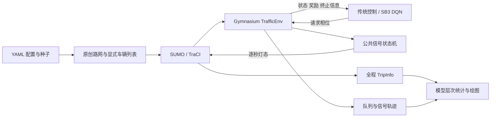
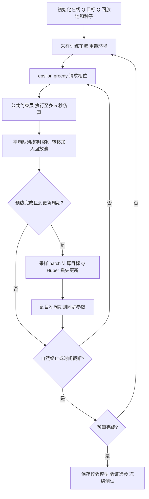

# 总体与算法设计

首版已经实现，下述均对应源码；正式多种子实验的效果尚待验证。

## 结构



| 模块 | 职责 |
| --- | --- |
| `config.py` | 参数和种子划分校验 |
| `demand.py` | 生成网络、显式车辆出发列表、SHA-256 清单 |
| `signals.py` | 最小/最大绿灯、黄灯、全红状态机 |
| `environment.py` | SUMO 生命周期、订阅观测、奖励、清空、全程指标 |
| `controllers.py` | 固定配时、队列感应式、等待老化控制 |
| `experiment.py` | 训练、验证选择、冻结参数、测试与来源记录 |
| `analysis.py` | 分层汇总、删失识别、图表与运行报告 |
| `replay.py` / `cli.py` | 已训练模型加载、运行与 GUI 入口 |
| `objectives.py` | 显式算法分支配置、全车辆连续公平成本 |

正式环境为本项目实现的 Gymnasium/TraCI 接口。SUMO-RL 仍用于独立的安装联通测试，
没有将其 `max_green` 参数误认为已执行的约束。DQN 的回放、目标网络和更新由
Stable-Baselines3 标准实现负责，不另写容易出错的学习内核。

## 路口与需求

原创四进口几何路网，路臂约 300 m，每条进/出口两车道，限速 13.89 m/s。
车道 0 承担直行/右转，车道 1 承担左转；相位依次为：

0. 南北直行/右转；
1. 南北左转；
2. 东西直行/右转；
3. 东西左转。

所有相位没有对向冲突放行。链接编号在生成后检查，仿真同时统计碰撞/传送事件。
这是教学模型，3 秒黄灯和 1 秒全红是实验参数，不能直接用于真实道路。

每个方向按分段恒定强度的泊松过程采样出发，转向比例为右转/直行/左转 10%/70%/20%。
车辆长度 5 m、最小间距 2.5 m、加速度 2.6 m/s²、减速度 4.5 m/s²，跟驰随机参数 sigma=0.5。
所有方法共用同一显式车辆列表和同一 SUMO 随机种子，路线文件保存 SHA-256。
物理状态会随控制变化，同种子并不意味着每辆车在不同策略下经历相同的跟驰随机数。

下表为训练基础强度，单位辆/小时，方向顺序 N/S/E/W；每行持续需求窗口的三分之一。

| 场景 | 第 1 段 | 第 2 段 | 第 3 段 |
| --- | --- | --- | --- |
| balanced | 270/270/270/270 | 同前 | 同前 |
| imbalanced | 110/110/450/450 | 同前 | 同前 |
| changing_peak | 380/380/120/120 | 120/120/420/420 | 280/280/280/280 |

训练每回合随机选场景、每方向再乘 U(0.8,1.2)；验证使用基础强度 ×1.05，测试 ×1.12。
这些是独立需求组合，仍接近训练分布，不能据此宣称分布外鲁棒性。
训练重置后的需求种子来自以训练种子初始化的环境 RNG，不读取验证/测试车流。
所有测试路线在学习前即可固定，但学习过程不访问它们。

## 状态、动作与信号约束

基础状态 22 维：4 维相位 one-hot、阶段已持续时间/60、是否处于清空阶段、
8 维车道车辆密度和 8 维停车队列密度。密度分母为车道长度/(5+2.5)。
增强状态 38 维：另加 8 维停车队首累计等待/180、8 维有需求但未获绿灯机会的时间/180。
所有观测截断到 [0,1]，奖励不截断。

队首是该车道上位置最靠前的停车车辆；其等待为车辆自进入路网起的累计停车时间。
车辆换车道后累计值跟随车辆 ID，特征归入它当前所在车道；车辆前进不会清零累计值。
无停车车辆时队首等待为零。请求年龄在车道有车且未获绿灯时累加，车道为空或绿灯服务时清零；
它衡量获得服务机会的时间，并不保证车辆实际驶过停止线。
首版采用车道而非四进口聚合，确保稀疏左转需求不会被同进口直行量遮盖。

动作空间为四相位请求；请求当前相位表示保持。每 5 秒请求一次，环境逐秒推进：

- 连续绿灯不足 10 秒：阻止切换并计数；
- 允许切换：原相位绿灯变黄 3 秒，全红 1 秒，再进入目标绿灯；
- 连续绿灯达到 60 秒且仍保持：强制切至循环后继相位，并记录强制次数；
- 黄灯/全红期间忽略新请求，继续此前确定的切换。

最大绿灯在逐秒层执行，不依赖决策周期对齐。固定配时也受 5 秒请求周期影响，
因此配置绿灯时长是请求阈值，实际可比阈值稍长，但不超过公共上限。
最大绿灯只能限制当前相位连续占用，策略仍可能跳过其他方向；不能宣称有硬等待上限。
该公共强制规则会影响所有控制器的行为，必须连同干预次数一起分析。
部分可观测、状态裁剪和到达过程意味着这是实用状态近似，并非完全可观测交通 MDP。

## 奖励与 DQN

逐秒计算，再对实际执行的至多 5 秒平均：

```text
Q = 所有进口车道停车车辆数 / 80
H = sum_i max(车道 i 停车队首累计等待 - 90, 0) / (8 * 180)
r = -Q - lambda * H
```

停车阈值为速度 ≤0.1 m/s；90 秒为实验软阈值，并非规范或服务承诺。
归一化常数事先固定，不用验证/测试统计估计。队首惩罚可能漏掉后方长期等待车辆，
因此最终仍用所有车辆的全程等待指标评估；可以将此作为后续改进点。

| 方法 | 观测 | 公平权重 |
| --- | --- | --- |
| dqn_queue | 基础 22 维 | 0 |
| dqn_wait | 增强 38 维 | 0 |
| dqn_fair | 增强 38 维 | 验证集从 0.1/0.3/1.0 选择 |

DQN 默认 CPU、单计算线程，MLP 128×128、学习率 3e-4、gamma=0.99、batch=64、
回放池 50000、前 1000 步探索预热、每 4 步一次梯度更新、目标网络每 1000 步更新。
epsilon 从 1 下降至 0.05，下降期为总预算的前 50%；测试用确定性贪心策略。
SB3 使用 Huber TD 损失、梯度裁剪和目标网络；这是标准 DQN，不声称实现 Double DQN。



`y = r + gamma * (1-terminated) * max_a Q_target(s_next,a)`。
自然终止为注入期结束且路网完全清空；清空阶段超过上限为 truncated。
SB3 对时间截断使用 terminal_observation 做 bootstrap；自然终止不 bootstrap。
最后一个不足 5 秒的决策仍使用相同 gamma，是首版离散时间近似。

## 传统控制与参数选择

固定配时循环执行四相位；候选为 [25,10,25,10]、[20,10,40,10]、[35,10,35,10]。
感应式为本项目透明的队列响应策略，不冒充 SUMO 内建 actuated 控制器：
相位分数为服务车道队列和 +0.01×在途车辆数，竞争相位须高于当前相位分数 1 才切换。
保持阈值在 10/20 秒选择。aging 在其上加入 0.1/0.3×该相位车道最大请求年龄。
这些候选较少，最终报告应将此视为基线调参范围的限制。

预先固定验证目标：各场景、车流、训练种子等权的 `mean_wait + 0.5 * p95_wait`。
仅完整、无异常、无传送/碰撞的候选参与选择；不使用测试指标选择权重或控制参数。
若某方法所有候选都失败，保留编号 0 作为诊断对象，标记 `diagnostic_only=true`，
继续记录测试失败；不在有删失的数据之间挑选表面平均等待最低者。

## 评价口径与可复现性

SUMO 的 [TripInfo waitingTime](https://sumo.dlr.de/docs/Simulation/Output/TripInfo.html)
为全程停车累计时间；正式评价读取该字段，不使用 TraCI 的有限记忆 accumulatedWaitingTime。
未抵达车辆也输出 TripInfo，单独记录其已累计等待，不混入已完成车辆 P95。
入网延迟另报 `mean_depart_delay`、`mean_wait_including_insertion` 与 `mean_system_time`，
避免短道路入口队列被隐藏。所有需求保留，不以超时删除车辆或传送缓解拥堵。

注入窗口平均/峰值队列使用固定注入时长作分母；清空队列与清空时长另报。
报告注入窗口内抵达数、最终完成数、未完成、未插入、异常移除、传送、碰撞、切换与干预。
TripInfo 已完成数须等于计划车辆数才可标记 valid_complete。
任何方法/场景有不完整回合，性能汇总留空，原始记录仍完整保留用于失败分析。

各测试回合先计算车辆平均/P95，再在每个训练模型内平均测试回合，最后跨训练种子
汇总均值和样本标准差。所报告 P95 为“回合 P95 的平均”，不是池化车辆 P95。
单训练种子不输出训练标准差，也不把逐车辆样本当作独立训练重复。
相位、车流、随机源、依赖版本、代码内容 SHA-256、模型/路线校验值随运行保存。
完全重现应保留对应代码、uv.lock 和整套运行产物；只拷贝 model.zip 不够。

## 后续改进分支

原始六种方法的行为保留，新增两个显式选择的实验方法：

| 方法 | 状态 | 公平成本 |
| --- | --- | --- |
| dqn_dense | 原增强 38 维 | 全路网停车车辆累计等待平方的逐秒增量 |
| dqn_dense_state | 完整信号状态、车道最大等待等 44 维 | 与 dqn_dense 相同 |

新状态分别给出当前/目标相位及 green/yellow/all_red，等待使用 `w/(w+180)`，
不在 180 秒后硬裁剪。信号约束与标准 SB3 DQN 内核不变。
新训练回合记录 queue_cost、fair_cost、weighted_fair_cost 与触发比例的决策步均值，
同时记录到 `traffic/` TensorBoard 标签。实际奖励的定义、检查发现与独立对照设计见
[改进实验记录](improvement-results.md)。

`dqn_fair_state` 保留原 `head_threshold` 公平奖励及验证选定的权重，
只启用 44 维 `service` 观测；它与两种连续奖励变体构成奖励×状态四格消融。
默认六方法列表不变，补充对照由 `configs/fair-state.yaml` 显式启用。

## 服务机会护栏（独立混合控制实验）

`scripts/service_guard.py` 对有车辆的车道请求年龄按四个相位聚合，
选择超过 180 秒阈值的最久未服务相位；只在绿灯且达到最小绿灯时改写当前请求。
原 `Signal` 仍负责黄灯、全红和最大绿灯，护栏不改变状态机。
它在推理阶段包裹固定模型，同样用于普通 DQN、Fair DQN 和传统感应式，
不参与 Bellman 更新，不称作训练时动作掩码。
`guard_study.py` 保存基础模型/路线/代码校验值和原请求、执行请求、接管标记。
请求年龄服务阈值不是全程车辆停车时间的硬上界。实际结果见 [长预算与护栏记录](long-budget-results.md)。
