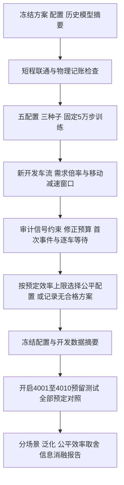

# 泛化、奖励对齐与信息消融实现

本轮独立于历史模块；原修正控制的动作、延长预算和服务护栏完全复用。
`IterationEnv(ResidualEnv, ScheduledArterialEnv)`通过方法解析顺序，把原修正动作交给
允许配置减速窗口的物理步进。物理循环仅替换窗口表达式，有AST等价检查及同车流精确回放检查。
未改变仿真秒长、最小/最大绿灯、黄灯、全红或清空结束条件。

## 首次超时奖励

逐车累计停车等待使用原SUMO订阅和记账。每秒记录刚从90进入91秒的停车车辆数，
车辆再次停车不会重新计数。新增奖励为：

`r = -mean(queue_cost) - lambda*mean(excess_cost) - K*first_crossings/(160*实际周期秒数)`。

queue包含全路网唯一停车车辆与到期未插入车辆，excess为累计等待>90秒的当秒停车车辆数/160。
末尾不足5秒的周期使用真实秒数。K=30/90对应首次事件的等价停车秒权重；lambda=0.25。
持续超时对照K=0、lambda=0.25；原普通版本lambda=0，原公平版本lambda=1。
折扣与近似学习存在，奖励对齐不保证超时比例一定下降。
首次事件仅针对停车等待，不针对插入延迟；报告同时保留完整行程与插入延迟指标。

## 信息消融

每个Q头结构相同，162输入、两层128、3输出；两个头参数独立，联合Q相加产生9个值。
full与local均75526个在线参数，原联合MLP为38537个，不能把两种结构之间的结果当成纯信息消融。
local头A保留索引[0,76)与[152,157)，头B保留[76,152)与[157,162)，其他输入乘零。
掩码是模型buffer，随在线和目标网络一起保存，重载后核对。
本地进出口包含连接道路，仍能间接感知邻路口影响；实验只测“额外读取另一节点状态”的价值。
两个配置共用全局回报、经验回放和训练器，不称为分布式MARL。

## 管线

`iteration_study.py`支持train/development/freeze/test；all顺序执行，测试前强制审计开发结果。
输出目录身份包含源码、配置、既有模型和规则参数摘要；不匹配拒绝续用。
已完成模型/回放可跳过，未完成训练从头重跑，不伪装成从检查点继续优化。
TensorBoard保留训练loss、队列、公平成本、首次超时与修正日志。
`summarize_iteration.py`核对完整实验矩阵、模型真实步数/更新次数、有限权重和日志，
复用历史物理/预算审计，并增加首次事件、减速窗口检查。
