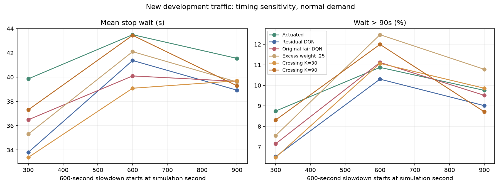
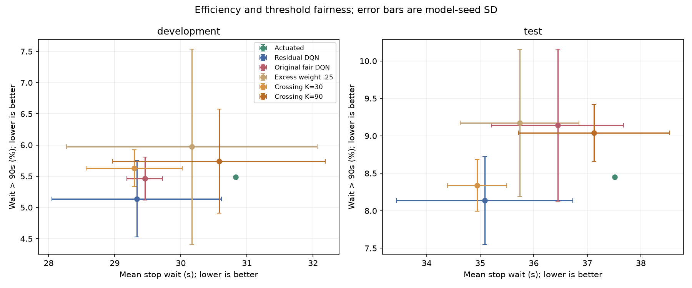

# 泛化、奖励对齐与信息消融结果

**已完成：15个新增模型、528个开发回合、720个预留测试回合；1248/1248回合完整，最终审计通过。**

测试前冻结的普通修正DQN相对感应式等待降低6.47%、完整行程缩短4.58%。
预定的本地加性Q对照均值进一步改善；首次超时奖励仍未达到降低普通版本超时比例的目标。

本轮没有扩大路网，重点检验既有收益能否泛化、首次超时奖励能否改善超时比例，以及额外邻路口观测是否有用。
预先方案见[iteration-plan.md](iteration-plan.md)，方法定义及流程见[实现说明](iteration-implementation.md)。

## 训练与评价口径

新增5配置×3训练种子11/22/33，各50000步，共750000步、183750次梯度更新。
1935个自然结束的训练回合全部清空；预算末尾未自然结束的训练片段不计入该完成率。
全部模型权重确有更新、保存重载一致，TensorBoard loss与交通指标有限。
原普通/公平修正DQN各3个模型保持冻结，三种传统参数保持上一轮选择，不在本轮重调。
训练阶段实测1791.46秒，约29.86分钟；主训练3进程，提前开发回放额外1进程，峰值4个实验工作进程。
提前回放改变执行排程，未改变算法、车流矩阵或选择标准；实测时间受并行负载影响。

开发种子3001/3002；三场景×三需求倍率，加两种移动减速窗口，共22条车流。
每条车流3个规则控制器＋7学习配置×3模型种子，合计528回合，全部完整。
需求倍率以原validation需求为基准；移动窗口单独统计，不追加到总体场景平均中。
先等权平均车流/场景，再平均模型种子；误差为3个模型种子均值的样本标准差，非置信区间。
P95为各回合P95的均值，停车等待不包含插入延迟，完整行程包含插入延迟。

## 正常需求的新开发车流

| 方法 | 平均等待(s) | 完整行程(s) | 超90秒比例 | P95(s) | 每车超时部分(s) |
| --- | --- | --- | --- | --- | --- |
| actuated | 30.83 | 111.80 | 5.49% | 88.20 | 2.75 |
| max_pressure | 31.94 | 110.35 | 6.50% | 100.57 | 3.50 |
| aging | 37.85 | 125.46 | 5.15% | 86.78 | 1.61 |
| residual_dqn | 29.33 | 108.47 | 5.14% | 87.38 | 2.31 |
| fair_residual_dqn | 29.45 | 108.74 | 5.46% | 83.71 | 1.46 |
| excess_025 | 30.17 | 109.76 | 5.97% | 89.49 | 2.22 |
| crossing_30 | 29.30 | 107.59 | 5.63% | 87.36 | 1.90 |
| crossing_90 | 30.58 | 110.96 | 5.74% | 87.78 | 1.93 |
| matched_full | 28.65 | 106.85 | 5.57% | 87.76 | 1.99 |
| matched_local | 27.88 | 105.11 | 5.10% | 87.44 | 1.84 |

完整误差与分场景结果见[summary.csv](results/iteration-50k/summary.csv)和[per_seed.csv](results/iteration-50k/per_seed.csv)。


## 普通修正DQN的泛化边界

| 条件 | 感应式等待(s) | 普通修正DQN等待(s) | 等待变化 | 完整行程变化 |
| --- | --- | --- | --- | --- |
| 需求0.8倍 | 23.30 | 23.85 | +2.39% | -0.30% |
| 需求1.0倍 | 30.83 | 29.33 | -4.85% | -2.98% |
| 需求1.2倍 | 45.06 | 41.83 | -7.17% | -6.93% |
| 减速提前至300秒 | 39.86 | 33.81 | -15.19% | -7.78% |
| 减速延后至900秒 | 41.55 | 38.93 | -6.30% | -4.16% |

需求变动行对三个场景等权，窗口移动行只包含下游减速场景，不能横向当成同一个总体。
普通策略在正常/较高需求及两种窗口移动下保持效率收益，低需求平均等待略有退化。
每种开发条件只有两个新车流种子，这是适用范围的描述性证据，不能据此声称普遍优势。




## 公平奖励：冻结选择为无合格配置

预定门槛为超90秒比例低于普通版本，平均等待及完整行程各不超过普通版本105%。
正常需求开发集普通版本超时比例5.139%，K=30为5.629%，K=90为5.742%。
两者均未达到超时比例条件，因此`freeze.json`中`selected_fairness=null`，不推广为公平改进。
K=30比仅持续权重0.25的对照更好，但没有超过普通版本的主公平指标；加大至90也未改善该结果。
原公平版本的平均超时部分仍较低，说明严重程度与曾跨过阈值的比例是不同目标。
奖励对齐有明确记账验证，但不保证在固定观测、动作与训练预算下得到更优策略。



## 信息消融：开发结果不支持更多信息必然更好

参数匹配的完整信息组平均等待28.65秒，本地信息组27.88秒；完整行程106.85与105.11秒。
在该开发集和5万步预算下，本地信息组均值更好，不能声称收益已经证明来自显式邻路口协同。
本地组仍保留本路口连接道路观测、全局训练回报；它不是完全独立的多智能体系统。
两个匹配组均75526参数，而原联合MLP为38537；原MLP与本地组之间的差异不是纯信息消融。
只有3个模型种子，暂不作统计显著性或更复杂路网上的外推。


## 测试前审计与冻结

49项常规检查及2项新的SUMO集成检查通过；其他历史集成检查本轮没有重跑。
528条逐秒轨迹、336676个完整物理信号区间通过检查，车辆记账、修正预算、超时积分与首次事件一致。
未清空/未插入、碰撞、传送和异常移除均为0。首次事件数与逐车累计等待>90秒的数量一致。
冻结记录包含源码、study及完整开发CSV摘要，明确`test_was_unopened=true`。
本轮控制源码摘要`ea8185c8ed7c2e3e5f51822ef14a121034a89cdf1881378e01d73a61baf51c44`，训练核心提交`4fbc9de`。
历史修正控制摘要仍为`5883f233241bcae6f543ee6b9bf20a3b7418cb7ffab7af879dd04e1079d618f8`，历史模型不改写。

冻结产物：[freeze.json](results/iteration-50k/freeze.json)、[quality.json](results/iteration-50k/quality.json)、
[逐回合数据](results/iteration-50k/evaluation.csv)、[成对差异](results/iteration-50k/paired.csv)。

## 预留测试：720/720完整

开发数据与`selected_fairness=null`在[测试前提交3eadcbc](https://github.com/Highsun/Fair-Signal/commit/3eadcbcfad0d1f46ddf1c017a05024e6bda3635f)中冻结，
随后才生成并评价4001–4010：3场景×10条车流，全部预定方法720回合。
原普通修正DQN是测试前固定的主策略；本地加性Q是预先规定的结构对照，未根据测试成绩重新选权重、种子或检查点。
以下全部方法都保留，没有只展示最优种子。`±`为三个模型种子均值的标准差。

| 方法 | 完整回合 | 平均等待(s) | 完整行程(s) | 超90秒比例 | P95(s) | 每车超时部分(s) |
| --- | --- | --- | --- | --- | --- | --- |
| actuated | 30/30 | 37.51 | 124.02 | 8.45% | 111.01 | 5.47 |
| max_pressure | 30/30 | 38.08 | 120.38 | 9.55% | 120.60 | 6.17 |
| aging | 30/30 | 45.44 | 144.64 | 9.46% | 109.06 | 4.46 |
| residual_dqn | 90/90 | 35.08±1.65 | 118.34±3.96 | 8.14±0.59% | 104.51±5.69 | 4.30±0.64 |
| fair_residual_dqn | 90/90 | 36.45±1.23 | 120.98±3.90 | 9.14±1.02% | 102.81±1.02 | 3.99±0.24 |
| excess_025 | 90/90 | 35.74±1.11 | 120.11±4.27 | 9.17±0.98% | 103.17±2.72 | 4.24±0.40 |
| crossing_30 | 90/90 | 34.94±0.55 | 116.91±2.76 | 8.34±0.34% | 104.54±3.82 | 4.17±0.43 |
| crossing_90 | 90/90 | 37.13±1.41 | 122.74±2.63 | 9.04±0.38% | 104.98±6.59 | 4.28±0.94 |
| matched_full | 90/90 | 34.19±0.99 | 115.65±2.18 | 7.97±0.44% | 102.32±2.85 | 3.98±0.61 |
| matched_local | 90/90 | 32.49±0.30 | 112.50±0.27 | 7.53±0.30% | 101.15±1.24 | 3.55±0.20 |

普通修正DQN相对感应式：平均等待−6.47%、完整行程−4.58%、超90秒比例−0.315个百分点。
这为强基线辅助控制的效率收益提供了新的预留测试支持，不等于纯DQN从零训练普遍超过传统控制。

### 公平改造没有通过预定目标

K=30相对仅持续权重0.25的对照：平均等待−2.22%、完整行程−2.67%、超90秒比例−0.832个百分点。
这个配对对照支持新增首次事件惩罚在该配置下有作用；但相对普通版本，超90秒比例仍增加0.205个百分点。
K=90也没有改善普通版本的超时比例，开发集“无合格公平配置”的选择保持不变。
K=30的完整行程比普通版本短1.21%，属于效率取舍，不能据此称为达成公平目标。

原公平版本相对普通版本：平均等待增加3.89%，超90秒比例增加1.007个百分点，
平均超时部分降低7.32%、P95降低1.70秒。严重程度仍有局部收益，但开发集约36.85%的严重程度降幅没有在测试中同幅度复现。
因此本轮没有支持公平版本稳定全面更优；也不把局部尾部收益概括为完全无用。
超时部分在本轮预先方案已列为辅助指标，不替换超90秒比例这个主公平指标。

### 信息消融：本地信息组的均值更好

本地加性Q相对参数匹配的完整信息组：等待−4.98%、完整行程−2.72%、超90秒比例−0.446个百分点。
相对原普通修正DQN：等待−7.39%、完整行程−4.93%；相对感应式：等待−13.38%、完整行程−9.29%。
三个配对模型种子的平均等待和完整行程均低于完整信息组；seed33的超90秒比例却较高，不能声称逐种子全面更好。
本地信息组的均值在开发和预留测试均较好，支持本轮5万步预算下“额外读取另一节点观测未带来收益”。
它仍使用本地连接道路状态和全局训练回报，不能推出交通协同无用，或更大路网上无需通信。
原MLP与加性结构同时改变参数量与函数形式，本轮也不能单独证明动作分解本身造成全部收益。

### 分场景：尾部问题仍存在

| 场景 | 方法 | 平均等待(s) | 完整行程(s) | P95(s) | 超90秒比例 |
| --- | --- | --- | --- | --- | --- |
| steady | actuated | 23.90 | 99.04 | 62.61 | 2.08% |
| steady | residual_dqn | 23.02 | 96.70 | 66.78 | 2.33% |
| steady | matched_local | 22.50 | 95.14 | 70.35 | 2.57% |
| tidal | actuated | 29.28 | 108.14 | 72.43 | 2.93% |
| tidal | residual_dqn | 27.93 | 104.35 | 76.00 | 3.17% |
| tidal | matched_local | 26.58 | 100.71 | 77.55 | 3.31% |
| downstream_slowdown | actuated | 59.36 | 164.88 | 197.99 | 20.35% |
| downstream_slowdown | residual_dqn | 54.31 | 153.96 | 170.73 | 18.91% |
| downstream_slowdown | matched_local | 48.40 | 141.64 | 155.55 | 16.70% |

本地组在三个测试场景的平均等待/完整行程均优于感应式，但稳定/潮汐的P95与超90秒比例仍更差。
例如稳定车流P95由62.61升至70.35秒，超90秒比例由2.08%升至2.57%；瓶颈收益不能掩盖这类退化。
本地/完整信息组之间，稳定与潮汐的P95也没有全面改善。
只有3个训练种子，本页报告均值与标准差，不作统计显著性或真实道路部署保证。

## 最终审计与运行成本

开发528＋测试720，共1248条轨迹、803071个完整物理信号区间通过审计。
所有回合清空，未插入/在途残留、碰撞、传送和异常移除均为0。
首次超时事件计数、逐车停车及持续超时积分、信号约束与延长预算均一致；21个被评价模型身份与实际训练预算核对通过。
15个新模型各12250次更新，6个旧模型完全复用；模型权重有限，保存重载及TensorBoard检查通过。
49项常规检查与2项新SUMO集成检查通过；其他历史集成检查本轮未重跑。

训练29.86分钟；最终测试阶段708.01秒，约11.80分钟，包含测试前开发审计。
提前回放与训练重叠，不能把所有执行记录简单相加。整个实验使用Mac CPU，无新增依赖、无需台式机GPU。
本地完整输出约1.8GB，模型/日志/原始轨迹位于`outputs/iteration-50k/`并被Git忽略；小型审计结果约3.66MB。

4001–4010现在已经用于最终评价，后续若再据此改算法，它们就属于已见数据，需要另留新的未见测试车流。
复现本轮固定方案仍可重用这些车流，但不能把复现称为一次新的盲测。

## 运行与回放

见[运行说明](running.md#泛化奖励对齐与信息消融)。完整模型与TensorBoard保留本地outputs，小型审计数据提交仓库。
新增回放入口已用独立联通模型及正式matched_local模型无界面精确核对；本轮未另行启动GUI实测。
联通模型128步，只用于流程检查，不作为本页性能结论。

```bash
bash scripts/run.sh python scripts/view_iteration.py --method matched_local \
  --seed 11 --case downstream_slowdown_rate1_3001 --delay 200
```

默认暂停，Play/Stop/Single Step控制播放，Delay越大越慢。
