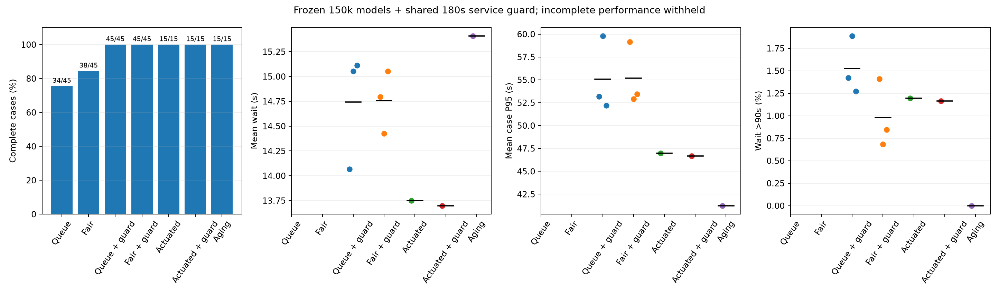

# 固定探索日程的长预算对照

本轮结论：加长训练暴露了相位饥饿，不能直接采用 15 万步纯 DQN。
共享服务护栏修复了本批 18 个末端失败回合，105 个混合控制验证回合全部清空。
Fair DQN＋护栏较普通 DQN＋同一护栏减少超 90 秒等待，且接管次数更少，
但传统控制仍是强基线；这属于混合控制的开发验证，非纯 DQN 胜出或最终盲测。

## 运行前固定的设计

上一轮的原公平 DQN 已降低超 90 秒比例，但三个改进变体没有表现出清晰优势。
此次只检验训练预算：普通 DQN 与原 Fair DQN（lambda=1），各训练种子 11/22/33，
从头不间断训练至 150000 决策步，保存 50000/100000/150000 步检查点。
只有六条独立训练轨迹，18 个检查点不能当成 18 次独立训练。

奖励、观测、MLP 128×128、经验池、学习率、折扣与信号规则不变。
探索率保持原来的前 25000 步衰减至 0.05；长预算配置 exploration_fraction=1/6，
避免同时延长探索期。5 万步检查点将与上轮各自模型逐项比较在线/目标网络参数。
全部检查点在对应梯度更新之后保存；不是 SB3 on_step 中提前一步保存。
检查点只写磁盘、不加载模型或评估；全轨迹训练完成后才做加载和验证，
避免评估初始化随机种子而改变后续训练。没有恢复旧模型/优化器/回放池的操作。

验证车流仍为三个场景 × 种子 1001–1005，所有检查点使用同一组路线。
每个预算有 90 个学习验证回合；15 万步另评估感应式与 aging，各 15 回合，
总计 300 个新验证回合。传统参数固定为 minimum=10、aging_weight=0.1。
不扫描权重、不丢弃训练种子、不挑选最好检查点，主结果为 15 万步预算末端。
先在模型内平均 15 条车流，再跨三个训练种子汇总均值和样本标准差。
普通 DQN 与原 Fair DQN 本身还存在 22/38 维状态差异；本次比较的是两套既定策略
随预算的变化，不能把它们之间的全部差异归因于公平奖励一个因素。
主要同时检查平均等待、P95 与超 90 秒比例；检查全部车辆完成与入网延迟。
预留种子 3001–3010 不生成、不评估。

本次只增加独立实验脚本，核心源码摘要保持上一轮不变；
`study.json` 另行保存实验脚本 SHA-256、完整配置、检查点与评估时机。
相同核心摘要不能代替新实验脚本身份核验。未完成的单条轨迹从头重跑，
已完成的整条轨迹及检查点经校验后可复用。

短预算联通检查使用 32/64/128 步三个检查点；
它只验证保存/更新/加载逻辑，不用于性能结论，极短清空窗口可能导致删失。
短预算两个方法的全部六个检查点，与标准训练器分别训练的等长前缀
在线/目标网络参数逐项完全一致，实际更新次数为 6/14/30。
检查记录见 [短预算前缀核对](results/long-budget-smoke/standard_prefix_check.json)。

## 运行入口

```bash
bash scripts/run.sh python scripts/long_budget_study.py --workers 3
bash scripts/run.sh tensorboard --logdir outputs/long-budget-150k/trajectories --host 127.0.0.1
```

配置：`configs/long-budget.yaml`；完整训练轨迹：`outputs/long-budget-150k/trajectories/`；
检查点模型与匹配验证：`outputs/long-budget-150k/step_<步数>/`。
各检查点的训练耗时是同一轨迹的累计值，不能跨检查点相加；
`execution.json` 只对六个终点的轨迹耗时求和，包含检查点保存开销。
训练完成后导出：

```bash
bash scripts/run.sh python scripts/summarize_long_budget.py
```

汇总检查模型 SHA-256、步数/更新次数、脚本身份、匹配路线、参数与行为前缀、
TensorBoard 日志和失败回合。单种子、部分方法的短预算导出也已实际测试：
四个末端验证回合均不完整，导出的候选性能全部留空，未把删失结果算作优势。
## 实际长预算结果

六条轨迹完成 900000 决策步、223500 次梯度更新，18 个检查点全部保存重载一致、
参数有限。三进程训练＋验证墙钟 1311.44 秒（21.86 分钟），
六条轨迹累计耗时 3230.76 秒（53.85 分钟，含检查点保存）。
前 5 万步六个模型的在线/目标网络参数与上一轮完全一致，
90 条旧验证回合和 30 条传统基线回合的每项指标精确复现。

| 预算 | 普通 DQN 完整回合 | Fair DQN 完整回合 |
| ---: | ---: | ---: |
| 50000 | 45/45 | 45/45 |
| 100000 | 43/45 | 45/45 |
| 150000 | 34/45 | 38/45 |

15 万步两种策略都存在删失，不能报告“只对已完成车辆”的全局性能均值。
包括传统控制的全部 300 个验证回合中，280 个完整、20 个失败，合计 30 辆车辆滞留；
没有未插入、碰撞或传送。训练更长没有稳定解决问题，不能宣称算法收敛。
5 万步仍复现上一轮结论；10 万步 Fair DQN 平均等待 15.52 秒、P95 56.09 秒、
超 90 秒比例 1.017%，未表现出相对其 5 万步的改善。
完整标准差、失败记录、来源和 TensorBoard 核对见
[长预算实际汇总](results/long-budget-150k/report.md)。

### 新定位的失效机制

20 个失败回合中的全部 30 辆滞留车辆，在末 600 秒都没有获得其所需相位的绿灯。
例如 Fair DQN 种子 11、changing_peak/1004，末段只在相位 1 与 2 间循环，
南进口直行车需要的相位 0 未服务，累计停车达到 1786 秒。
原公平成本在该失败末段明确非零，因此不是“惩罚没有接入”。

最大绿灯只限制当前相位驻留，强制切换到下一相位后，策略仍能返回原相位，
因而不能保证所有有需求相位最终被服务。状态裁剪会让超长等待不可区分，
但具体策略为何在低需求尾段形成该循环，不能仅凭轨迹归因于某一网络机制。
原始轨迹与未完成 TripInfo 支持明确的相位饥饿诊断。
逐车辆证据见 `results/long-budget-150k/starvation_audit.csv`。

## 后续开发对照：共享服务护栏

这是看过长预算失败后的补充开发试验，不是预先声明的最终盲测。
固定阈值 180 秒：如果有需求相位的请求年龄超过阈值，
在绿灯且满足最小绿灯约束的决策点，优先请求最久未服务相位。
过渡期不改已提交的目标，不跳过黄灯/全红，也不修改原信号状态机。
该规则提供服务机会，不声称给实际车辆等待时间或拥堵溢出提供硬保证。

固定 15 万步末端模型，分别比较普通 DQN＋护栏、Fair DQN＋同一护栏、
感应式＋同一护栏；仍为同一 15 条验证路线，学习模型使用全部三个种子。
新增 105 回合，不再训练、不扫描阈值、不重选检查点，不使用最终测试。
同时报告护栏接管次数及需求窗口/清空阶段的分布，并保留不带护栏的失败结果。
它们是推理时的混合控制器，不能把修复效果归功于深度强化学习独立学得的能力。
对感应式也使用相同规则，以区分护栏与学习策略的贡献。

```bash
bash scripts/run.sh python scripts/guard_study.py --workers 3
```

纯状态机测试覆盖：原常量请求在两个相位循环时确实饥饿，护栏能为全部有需求相位
提供服务；不在最小绿灯、黄灯或全红期间抢占，不响应无需求的陈旧年龄。

## 共享服务护栏的实际结果

105/105 个新增验证回合全部完成，未完成、未插入、碰撞和传送均为零。
三进程墙钟 92.53 秒，无新增训练或模型参数更改。
原普通 DQN 的 11 个、原 Fair DQN 的 7 个末端失败回合均恢复完成，没有新失败。
逐回合信号轨迹也核查了最小/最大绿灯 10/60 秒、黄灯 3 秒、全红 1 秒及阶段顺序；
最后自然结束的非完整阶段不误判为违反最小时长。

| 15 万步末端控制器 | 完整回合 | 平均等待 s | 平均回合 P95 s | 超 90 秒比例 |
| --- | ---: | ---: | ---: | ---: |
| 普通 DQN | 34/45 | — | — | — |
| 原 Fair DQN | 38/45 | — | — | — |
| 普通 DQN＋共享护栏 | 45/45 | 14.74±0.59 | 55.05±4.12 | 1.526%±0.320% |
| Fair DQN＋共享护栏 | 45/45 | 14.76±0.32 | 55.17±3.46 | 0.980%±0.382% |
| 感应式 | 15/15 | 13.75 | 46.99 | 1.195% |
| 感应式＋共享护栏 | 15/15 | 13.70 | 46.67 | 1.166% |
| aging | 15/15 | 15.41 | 41.24 | 0.000% |

± 是三个训练种子模型均值的样本标准差；传统控制没有训练标准差。
同一护栏下 Fair 相对普通 DQN：平均等待增加 0.014 秒，P95 增加 0.116 秒，
超 90 秒比例降低 0.546 个百分点（约 35.8% 相对降幅）。
三个训练种子的超时差异方向都相同，但种子 11 的改善很小，不声称统计显著。
不能从已失败纯 DQN 的已完成车辆指标计算一个“全局等待改进率”，
因此该类成对性能差异仍留空，只报告恢复/新增失败的回合数。

Fair＋护栏共接管 20 次（需求窗口 12、清空阶段 8），
普通＋护栏 111 次（需求窗口 99、清空阶段 12），
感应式＋护栏 34 次（全部在需求窗口）。这表明 Fair 混合控制在本批车流中
较少依赖护栏；护栏对正常交通也有作用，不能描述成只在清空末尾切换。
原 Fair 与普通 DQN 存在状态和奖励的共同差异，不能单独归因于 lambda。

观察到的最大车辆累计等待为 Fair＋护栏 193 秒、普通＋护栏 191 秒、
感应式＋护栏 185 秒，明确说明 180 秒服务请求阈值不是车辆等待上界。
最长清空时间分别为 236、231、91 秒，没有靠延长原来的 1800 秒清空上限来修复。



### 本轮采用与保留的方案

- 以“Fair DQN＋共享服务护栏”作为下一阶段的实用混合控制候选，
  普通 DQN＋相同护栏、感应式＋相同护栏和 aging 都保留为比较对象。
- 原纯 DQN 与其失败轨迹仍然保留；已有默认六方法和历史 GUI 行为不被静默替换。
  新控制器代码在 `scripts/service_guard.py`，运行入口为 `scripts/guard_study.py`。
- 不继续堆叠训练预算或搜索护栏阈值。下一步先冻结设计，
  用独立开发车流检验对新流量/需求结束时刻的泛化，再决定最终测试。
  预留种子 3001–3010 仍然没有生成或评估。

完整小体积数据、三种子均值、分场景结果、干预分布和成对差异见
[护栏实验汇总](results/service-guard-150k/report.md)。
本轮共运行 300 个长预算验证与 105 个补充验证；不能把历史基线引用算作新回合。
新增两项纯状态机测试后，单元测试共 28 项通过；原模型与算法核心源码摘要保持不变。
