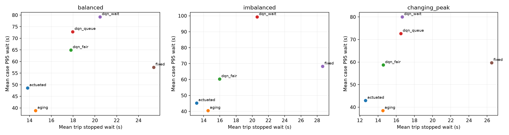
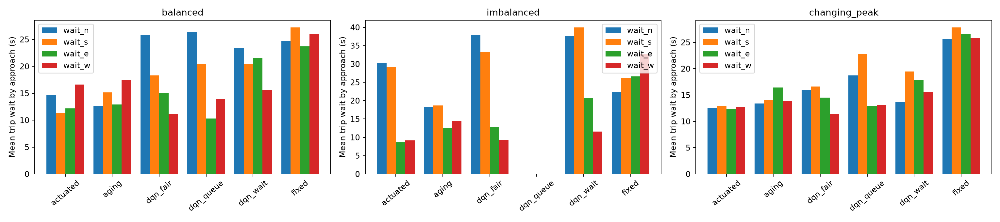
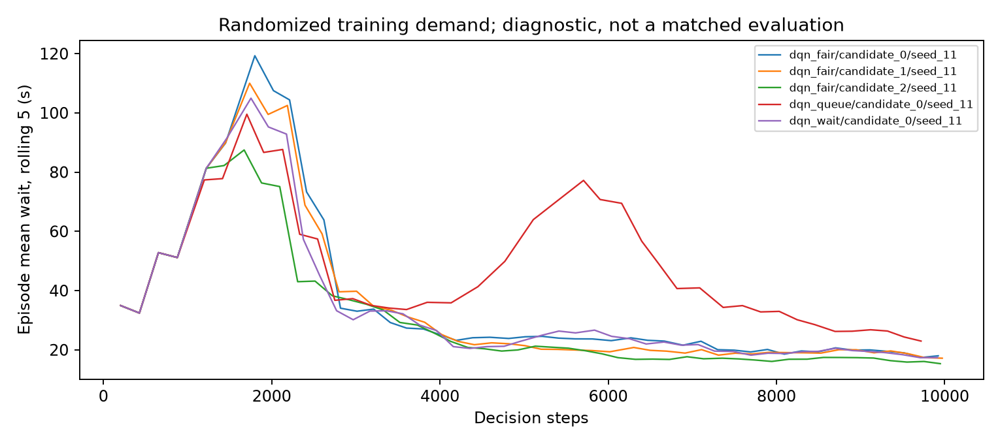

# 首轮短跑：实际结果与分析

运行日期：2026-10-11。MacBook Pro M3 Pro、18 GB 内存，CPU 单线程，无 GPU。

已完成原创环境、传统控制、三个 DQN 消融、验证选参和独立测试的完整流程。
这轮结果尚不支持 DQN 优于传统控制；等待老化基线提供了更好的尾部等待。
所有表格均来自实际运行，没有把环境 smoke 当作性能实验。

## 设置与工程验证

- 每个学习配置 10000 决策步，训练种子 11；普通 DQN、等待状态 DQN，公平权重 0.1/0.3/1.0，共 5 个模型。
- 每回合注入 900 秒车流，再允许最多 900 秒清空；三个场景。
- 验证种子 1001/1002，共 84 个候选评估回合；仅验证结果用于参数选择。
- 测试种子 2001/2002，共 6 条车流、1746 辆计划车辆，每条车流被 6 种方法复用，共 36 回合。
- 单元测试 11 项、真实 SUMO 集成测试 2 项通过；包含恶劣策略删失、信号约束、计时和模型重载。
- 在线累计停车等待与 SUMO 独立 TripInfo 全程等待逐车一致。
- 5 个模型均实际更新参数，各有 2250 次梯度更新，并通过保存/重载动作检查。
- 单独加载公平 DQN 回放 imbalanced/2001，与原测试的全部指标完全一致。
- 所有同场景/种子方法的车流 SHA-256 一致；测试无传送、碰撞或未插入车辆。

## 验证选择

固定绿灯阈值 [25,10,25,10]；感应式最小保持 10 秒；aging 最小保持 10 秒、老化权重 0.1。
公平 DQN 选择 lambda=1.0，验证目标为事先固定的 mean_wait + 0.5×P95。
lambda=0.3 在 balanced/1002 和 imbalanced/1001 未完全清空，分别有 6 和 9 辆滞留，
未参加选参；lambda=0.1 的合法验证评分为 56.91，lambda=1.0 为 48.80。
这些候选差异包含短训练的随机波动，不能视为权重大小与公平收益的单调关系。

## 固定测试

P95 列为每个测试回合 P95 的平均。每个场景只有两条车流、一个训练模型，未估计训练方差。
有任何不完整回合的方法/场景不输出汇总性能；原始删失统计仍保留在 test.csv。

| 场景 | 方法 | 完整回合 | 平均等待 s | 平均回合 P95 s | 超 90 秒比例 |
| --- | --- | ---: | ---: | ---: | ---: |
| balanced | actuated | 2/2 | 13.82 | 48.60 | 0.014 |
| changing_peak | actuated | 2/2 | 12.62 | 42.95 | 0.005 |
| imbalanced | actuated | 2/2 | 13.13 | 45.28 | 0.015 |
| balanced | aging | 2/2 | 14.56 | 38.88 | 0.000 |
| changing_peak | aging | 2/2 | 14.52 | 38.50 | 0.000 |
| imbalanced | aging | 2/2 | 14.54 | 40.50 | 0.000 |
| balanced | dqn_fair | 2/2 | 17.80 | 64.97 | 0.028 |
| changing_peak | dqn_fair | 2/2 | 14.57 | 58.70 | 0.015 |
| imbalanced | dqn_fair | 2/2 | 15.96 | 60.30 | 0.018 |
| balanced | dqn_queue | 2/2 | 17.96 | 72.85 | 0.033 |
| changing_peak | dqn_queue | 2/2 | 16.51 | 72.65 | 0.039 |
| imbalanced | dqn_queue | 1/2 | — | — | — |
| balanced | dqn_wait | 2/2 | 20.47 | 79.20 | 0.044 |
| changing_peak | dqn_wait | 2/2 | 16.67 | 80.00 | 0.040 |
| imbalanced | dqn_wait | 2/2 | 20.59 | 99.27 | 0.040 |
| balanced | fixed | 2/2 | 25.39 | 57.50 | 0.000 |
| changing_peak | fixed | 2/2 | 26.49 | 59.70 | 0.000 |
| imbalanced | fixed | 2/2 | 28.68 | 68.28 | 0.006 |

测试 35/36 回合完全清空。普通 DQN 在 imbalanced/2001 留下一辆南进口直行车：
计划 899.879 秒出发，实际 900 秒入网，仿真 1800 秒截断时累计停车等待 875 秒。
这是稀疏请求可能饥饿的具体失败案例，最大连续绿灯约束并不保证每个方向获服务。
公平 DQN 的六个测试回合全部清空，但不是任何车流下无饥饿的证明。



## 目前能够得出的结论

感应式在本轮六条测试车流上的平均等待均值为 13.19 秒，aging 为 14.54 秒，
选出的公平 DQN 为 16.11 秒；对应平均回合 P95 为 45.61、39.29、61.33 秒。
aging 用约 1.35 秒平均等待代价换取约 6.32 秒的 P95 下降，六条测试车流没有超过 90 秒的已完成车辆。
在当前低至中等负载和小样本中，简单等待规则已是有竞争力的基线。

公平 DQN 在均衡/时变场景相较普通 DQN 的 P95 更低，但尾部等待仍差于 aging；
不均衡场景的普通 DQN 有失败回合，不能用已完成车辆均值给它与公平 DQN 排名。
仅增加等待状态的 DQN 这次没有表现更好。状态维度、短训练收敛和不同车流影响仍需更多种子验证。
本轮不能证明公平奖励的稳定因果收益，也不能宣称深度强化学习有整体优势。



学习图是随机训练回合的原始等待诊断，车流在变，不应将曲线下降直接解释为同分布测试收益。
不同奖励的累计回报也不能直接比较。



## 算力与文件规模

| 模型 | 公平权重 | 训练秒数 | 决策步/秒 | 参数量 |
| --- | ---: | ---: | ---: | ---: |
| dqn_fair | 0.1 | 70.69 | 141.5 | 22020 |
| dqn_fair | 0.3 | 70.37 | 142.1 | 22020 |
| dqn_fair | 1.0 | 70.55 | 141.7 | 22020 |
| dqn_queue | 0.0 | 64.65 | 154.7 | 19972 |
| dqn_wait | 0.0 | 69.96 | 142.9 | 22020 |

五次纯训练合计 346.22 秒；该计时含训练回合的仿真重启，不含验证/测试。
完整本机实验目录约 60 MB（含模型与原始轨迹），不含已经安装的 Python、依赖和缓存。
这是当前短回合负载的实际吞吐，不可直接外推成正式长回合的保证耗时。
Mac 足以执行首版；尚无必须使用 RTX 台式机的证据。

## 下一阶段与复现

正式预算前先在验证集检查更长训练的稳定性、清空成功率及奖励尺度，
再决定是否投入完整 3 训练种子、30 万步矩阵。保留原始负面结果，避免只选最好看的检查点。
本轮测试已成为开发资料；正式配置预留新测试种子 3001–3010，不能继续用 2001/2002 充当最终盲测。
更广泛的需求、基线候选和鲁棒性实验仍未执行，GUI 渲染也未验证。

[固定配置](results/pilot-10k/config.json)、[测试原始指标](results/pilot-10k/test.csv)、
[验证评分](results/pilot-10k/validation_scores.json)、[参数选择](results/pilot-10k/selection.json)、
[模型与耗时记录](results/pilot-10k/training.json)、[运行来源](results/pilot-10k/provenance.json)。
模型和全量仿真文件在本机 outputs/pilot/，默认不随 Git 推送。

执行时尚未提交新实现，因此 provenance 的 git_dirty 为 true，Git revision 指向当时基线。
实际源码、pyproject 和 uv.lock 的内容 SHA-256 为：

`f4ba62f4454c52fb0c2f10c49d127fce6771b215ac639d9f27b019fdc399f812`

结果随包含同一代码内容的提交保存。可在该版本用以下命令核对内容身份：

```bash
bash scripts/run.sh python -c 'from fair_signal.experiment import source_digest; print(source_digest())'
bash scripts/run.sh fair-signal replay --run outputs/pilot --method dqn_fair \
  --seed 11 --scenario imbalanced --traffic-seed 2001 --output outputs/replay
```

完整运行、清理和跨机器说明见 [运行指南](running.md)。
