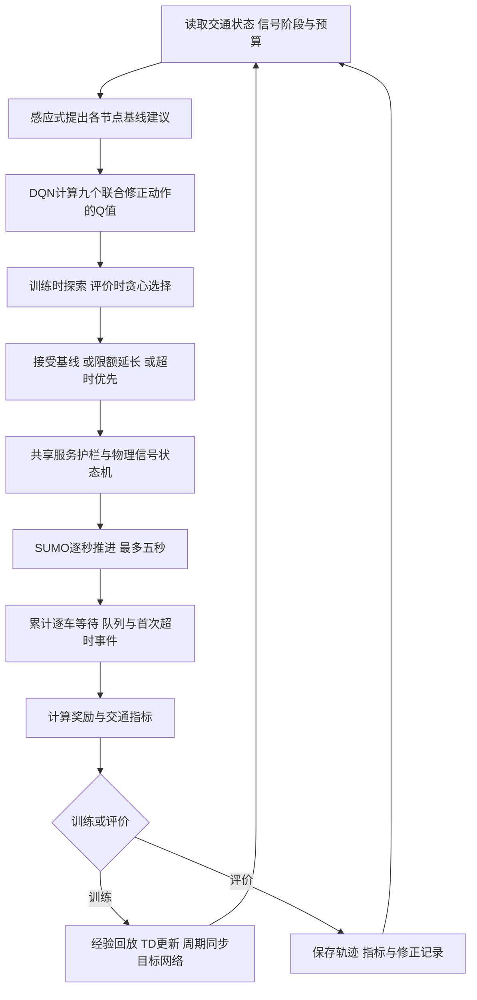
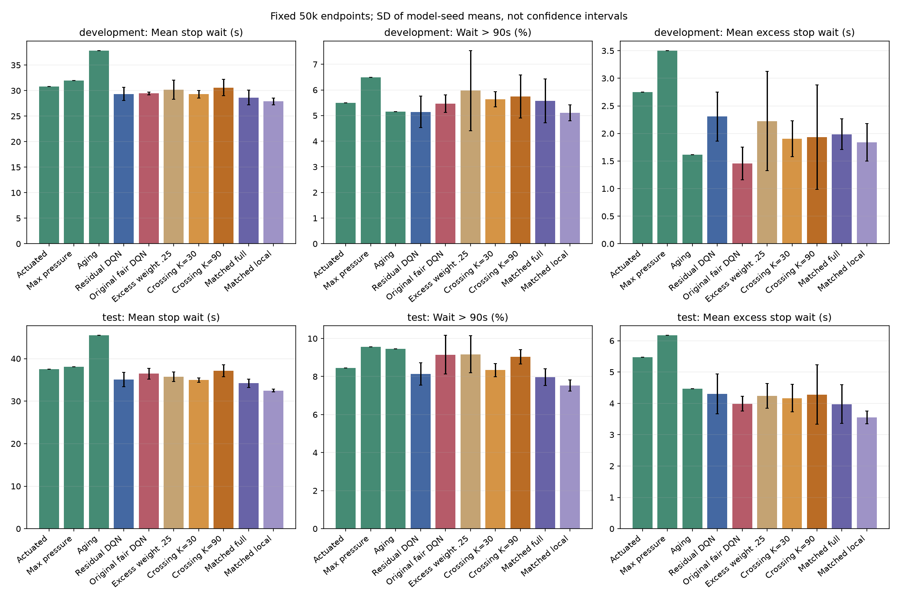
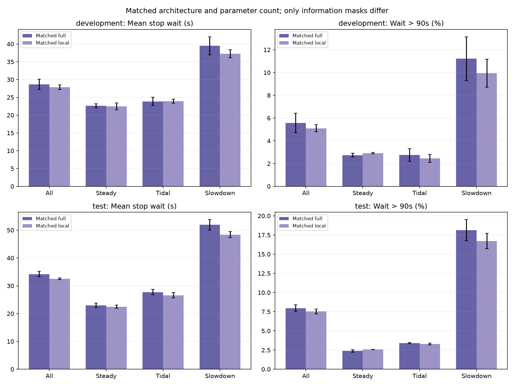
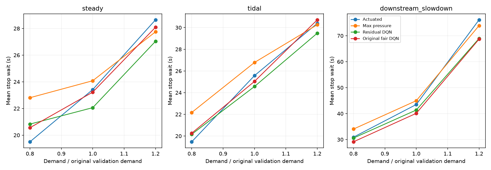

# Fair Signal 项目阶段梳理

整理日期：2026-10-12。对应代码与实验基线提交：`9005e2e`。

这是一份便于回顾、讨论和后续整理材料的非正式报告，不是最终课程作业报告。
本文综合现有源码、配置、实验记录与导出数据，不包含新的训练或算法改动。
历史文档保留当时的判断与后续计划；本文以最新已完成实验为准，区分已证实的结果、可能解释与未完成工作。

## 1. 当前项目做到哪里了

项目已具备完整的仿真、训练、评价、审计、绘图和回放能力，最新两路口方案也完成了预留测试。
目前最适合进入成果整理阶段，不需要为了获得一个更好看的排名继续增加路网或训练预算。

现阶段最有依据的主线是：**在强感应式控制器之上，由 DQN 学习有限的信号修正，检验效率收益、公平性取舍和观测信息的作用。**

三个核心发现如下：

1. 普通修正 DQN 在预留测试中，相对感应式平均等待降低 **6.47%**，完整行程缩短 **4.58%**。这是混合控制方案的收益。
2. 公平奖励尚未达到“在效率代价受限时降低超90秒车辆比例”的预定目标。降低超时严重程度与减少超时车辆数是不同任务。
3. 参数匹配的信息消融中，本地信息加性 Q 组的平均等待比完整信息组低 **4.98%**。在当前规模和训练预算下，额外读取另一节点观测未带来收益。

本地组相对感应式平均等待降低13.38%，但它是预先设置的结构对照；测试前冻结的主策略仍是普通修正 DQN。
没有根据测试结果重新选模型、种子或检查点，也不把本地组的结果表述为显式邻路口协同已经成功。

## 2. 问题与范围

交通信号需要在多个有需求的方向之间分配通行机会。只追求总排队较小，可能使少量车辆等待很久；
过度优先长等待方向，又可能增加切换损失和总体行程。项目关注效率与车辆长尾等待之间的取舍。

最初采用单路口，之后扩展为两个相距350米、通过真实道路连接的四岔路口。
车辆可以连续经过两个路口，累计停车等待在经过第一个路口后不会清零。
最新实验采用三类合成车流：

| 场景 | 设置与用途 |
| --- | --- |
| `steady` | 稳定干道车流，考察常规控制效率 |
| `tidal` | 车流方向随时间变化，考察对潮汐需求的适应 |
| `downstream_slowdown` | 下游出口在指定时间段减速，考察瓶颈与上下游影响 |

每回合注入1800秒需求，再允许最多900秒清空。标准减速窗口为600–1200秒；
最新开发实验另外移动窗口、改变需求强度，检验原有收益是否依赖某个固定时间或流量。

所有控制器服从共同物理约束：每5秒决策，最小绿灯10秒、最大绿灯60秒、黄灯3秒、全红1秒。
最新两路口方法还共用180秒服务请求护栏。它按有需求方向的未服务时间提供服务机会，
**不是车辆实际等待的180秒上界，也不保证路网一定清空。**

这里的“实际问题”是交通信号调度，验证平台是合成 SUMO 仿真；尚未使用真实城市路网、实测车流或实地部署。
公平性主要指车辆长尾等待，不等同于每个方向、不同人群或不同交通方式都公平。

## 3. 代码与工具的组织

所有代码和实验内容位于 `code/`，Git 根目录也位于此处。仓库已连接 GitHub，原创代码采用 MIT 许可证。
Python 及依赖由项目内的 uv 环境管理，SUMO 为全局安装，macOS GUI 使用 XQuartz。
核心工具为 SUMO/TraCI、Gymnasium、PyTorch、Stable-Baselines3 和 TensorBoard。

| 位置 | 职责与当前用途 |
| --- | --- |
| `src/fair_signal/signals.py` | 物理信号状态机与绿灯、黄灯、全红约束 |
| `src/fair_signal/environment.py`、`objectives.py` | 历史单路口环境、状态与公平成本 |
| `src/fair_signal/experiment.py`、`analysis.py`、`replay.py` | 单路口训练、统计与模型回放 |
| `src/fair_signal/arterial/` | 两路口路网和车流、152维状态、传统控制器、直接相位控制及物理审计 |
| `src/fair_signal/residual/` | 强基线辅助环境，162维观测和9个联合修正动作 |
| `src/fair_signal/iteration/` | 首次超时事件成本、可移动减速窗口、需求变化与参数匹配的信息消融 |
| `scripts/*_study.py` | 各轮独立实验入口；最新入口为 `iteration_study.py` |
| `scripts/summarize_*.py` | 检查实验完整性并导出统计、审计记录与图表 |
| `scripts/view_*.py` | 加载冻结模型和已评价案例，进行 GUI 或无界面精确回放 |
| `configs/` | 各轮固定配置；最新配置为 `iteration.yaml` |
| `tests/` | 纯逻辑检查及真实 SUMO 集成检查 |
| `outputs/` | 本地模型、TensorBoard、路线、TripInfo 和逐秒轨迹，被 Git 忽略 |
| `docs/results/` | 随 Git 保存的小型 CSV、JSON、图表和来源记录 |

新实验采用独立模块与输出目录，保留历史模型、失败案例和原有算法身份。
这样可以回顾设计变化，也避免改了算法之后仍把旧目录当作新结果使用。

## 4. 当前算法如何工作

### 4.1 传统控制器承担基础调度

本项目的感应式 `actuated` 是明确实现的队列规则，不是 SUMO 内置感应式控制程序。
它为每个相位计算“对应进口停车车辆数＋0.01×车辆数”，满足最小保持时间后，
只有候选得分高于当前相位得分加滞回阈值才请求切换。冻结参数为最小保持10秒、滞回阈值1。

它的优势是直接使用当前需求、无需训练，并通过最小绿灯和滞回减少无意义切换。
在小路网和相对常规的需求下，这种先验已经很强，DQN 需要同时学会这些基础规则并处理探索代价。
这有助于解释传统方法为何难以超过，但不是本项目通过消融证明的唯一原因。

其他基线包括：

- `max_pressure`：归一化、转向加权的上下游压力变体，考虑下游占用；不代表所有压力控制算法或其最优调参。
- `aging`：在队列得分上增加服务请求年龄，优先较久没有服务机会的方向；请求年龄不同于某辆车的累计等待。
- 历史实验还包含固定配时、协调固定配时，以及“总是延长”“总是超时优先”等修正规则对照。

### 4.2 DQN 学习何时修正基线

早期 DQN 直接选择物理绿灯相位：单路口4个动作，两路口联合为16个动作。
当前方案把基础服务交给感应式，DQN 在每个路口选择以下修正之一：

| 本地动作 | 含义 | 执行限制 |
| --- | --- | --- |
| 0 | 接受基线建议 | 使用原感应式逻辑 |
| 1 | 暂缓基线切换，继续当前相位5秒 | 当前相位有车、基线准备切换且预算允许 |
| 2 | 优先最长等待对应相位 | 存在累计停车等待达到90秒的车辆，否则接受基线 |

两个路口各3个选择，联合动作 `a = 3*c_A + c_B`，共9个。
每段物理绿灯的显式延长预算为10秒，不因动作交替而刷新；黄灯、全红和未满足最小绿灯时不能绕过状态机。
服务护栏可以覆盖修正请求，最大绿灯约束仍生效。

预算限制的是显式延长动作，不限制整条轨迹与未修正基线之间的绿灯差；超时优先动作也可能影响保持时间。
因此“有限修正”不意味着具有不劣于基线的理论保证。
这里的 residual 指决策修正，不是神经网络的残差连接。

### 4.3 状态、奖励与学习器

每个路口的基础观测为76维，包含当前/目标相位、信号阶段和计时、进口数量与队列、
车道分段占用、出口数量、最大累计等待与请求年龄。两路口共152维；
再添加每个节点4维基线建议和1维延长预算使用比例，得到162维观测。
这是交通局部观测构成的近似状态，没有证明满足严格的马尔可夫性。

当前奖励可统一写为：

```text
r_t = -mean(queue_cost)
      - lambda * mean(excess_cost)
      - K * first_crossings / (160 * 本步实际仿真秒数)
```

`queue_cost` 是全路网唯一停车车辆数加到期未插入车辆数，再除以160。
`excess_cost` 是本秒仍在停车、且全程累计停车等待超过90秒的车辆数除以160。
`first_crossings` 记录车辆累计停车时间首次从90秒进入91秒的事件，一个物理车辆只计一次。
前两项按该决策周期内的仿真秒取均值，最后不足5秒时使用真实秒数。

持续超时成本的无折扣逐秒积分对应超90秒部分的总时长；首次事件更接近超时车辆数量。
实际学习还包含决策步折扣、周期平均和函数近似，奖励与指标对齐不保证最终指标改善。

学习器使用 SB3 标准 DQN：epsilon-greedy 探索、经验回放、目标网络和 TD 更新，未加入 Double DQN、Dueling 或 PER。
标准目标为 `y = r + gamma * max Q_target(s', a')`，真正终止时不加后续价值；时间上限截断按框架规则处理。
最新新增模型的固定设置为：

| 项目 | 设置 |
| --- | --- |
| 训练种子与预算 | 11/22/33，每模型50000决策步，评价预算终点 |
| 隐藏层 | 128×128 |
| 学习率、折扣 | 0.0003、0.99 |
| 经验池、批大小 | 50000、64 |
| 开始更新、更新频率 | 1000步后，每4步更新一次 |
| 目标网络同步 | 每1000步 |
| 探索 | 前半预算衰减，最终 epsilon=0.05 |
| 计算设备 | Mac CPU，每工作进程1个 PyTorch 线程 |



### 4.4 最新比较中的十种方法

| 方法名 | 与其他方法的关系 |
| --- | --- |
| `actuated` | 冻结的感应式规则，无学习修正 |
| `max_pressure` | 冻结的压力控制变体 |
| `aging` | 冻结的请求年龄规则 |
| `residual_dqn` | 普通修正 DQN，lambda=0、K=0；复用上一轮3个模型 |
| `fair_residual_dqn` | 相同观测和网络，lambda=1、K=0；复用上一轮3个模型 |
| `excess_025` | lambda=0.25、K=0，首次事件奖励的匹配对照 |
| `crossing_30` | lambda=0.25、K=30 |
| `crossing_90` | lambda=0.25、K=90 |
| `matched_full` | lambda=0、K=0，两个加性 Q 头，每头读取完整状态 |
| `matched_local` | 与 full 相同结构和参数量，每头只保留本节点状态和基线/预算信息 |

原联合 MLP 为38537个在线参数；两个匹配组均为75526个在线参数。
匹配组满足 `Q(s,a_A,a_B)=Q_A(s,a_A)+Q_B(s,a_B)`，每头输出3个值，组合得到9个联合 Q 值。
本地组用固定掩码屏蔽另一节点输入，掩码随在线/目标网络保存和核对。

full/local 之间可以讨论额外邻节点观测的作用；原 MLP 与加性网络之间同时改变了结构和容量，不能只归因于动作分解。
两个匹配组都用全局奖励、联合经验回放和同一训练器，不是独立训练的多智能体 DQN。
本地组仍看到连接道路，所以也不是完全看不到邻路口影响。

## 5. 已完成实验的演进

下面按实验目的梳理。各轮路网、需求窗口、预算和评价集不同，**不能把跨轮绝对等待值当成同条件改进曲线**。
模型数不包含 smoke；检查点、精确回放和重复车流也不能都算成独立样本。

| 阶段 | 已完成规模 | 主要发现与设计影响 |
| --- | --- | --- |
| 单路口短跑 | 5模型×1万步；84候选验证回合、36测试回合 | 测试35/36完整，普通 DQN 有相位饥饿；感应式效率强，aging 长尾更好。证明管线可用，未证明学习优势 |
| 单路口加长验证 | 5模型×5万步，单训练种子；210/210验证完整 | 普通 DQN 等待14.27秒、原公平14.96秒、感应式13.75秒；公平版本降低超90秒比例但 P95 更高 |
| 奖励与状态对照 | 首批15模型＋补充3模型，各5万步；315/315验证完整 | 三种子原公平策略超时比例较普通低，但传统基线仍强；连续奖励、完整状态及其组合未形成稳定全面优势 |
| 单路口长预算 | 6条轨迹各15万步，保留5/10/15万步18个检查点；300验证回合中280完整 | 15万步普通34/45、公平38/45完整；清空尾段相位饥饿，增加训练不保证更可靠 |
| 共享护栏对照 | 固定15万步模型，不重训；新增105/105回合完整 | 本批18个末端失败回合恢复完成，但效果属于规则与学习的混合控制；感应式仍有竞争力 |
| 两路口直接相位控制 | 9模型×5万步；72调参回合完整，195开发回合中194完整 | 感应式等待32.08秒，本地 Q 40.32秒、公平联合49.05秒；普通联合有清空失败。增加路口没有自动带来学习优势 |
| 强基线辅助 DQN | 6模型×5万步；165/165开发回合完整 | 普通修正等待30.35秒，相对同车流感应式下降5.41%；公平版本超时严重程度更低，但超时比例未改善 |
| 最新泛化、奖励与信息消融 | 新增15模型×5万步，复用6旧模型；528开发＋720预留测试回合全部完整 | 普通修正效率收益得到新测试支持；首次超时奖励未达目标；本地信息组均值优于参数匹配的完整信息组 |

单路口长预算的20个失败包括10万步2个和15万步18个；护栏对照针对15万步终点，不能说它复测修复了全部20个历史失败。
首轮短跑测试后来成为开发资料；单路口早期预留的30万步正式矩阵并未执行。
最终两路口方案已经有独立测试，不需要将早期未执行计划冒充为已完成工作。

两路口直接相位模型的失败也保留了精确诊断：5辆车停在连接路段，模型大量请求无需求相位，
所需相位虽得到护栏提供的短绿灯机会，但服务时间不足。这再次表明“给过绿灯”不等于“车辆已通过”。

历史证据入口：[短跑](pilot-results.md)、[加长验证](stability-results.md)、[奖励与状态](improvement-results.md)、
[长预算与护栏](long-budget-results.md)、[两路口首轮](arterial-results.md)、[强基线辅助开发](residual-results.md)。

## 6. 最新一轮的实验与结果

### 6.1 开发、选择与最终测试的分工

新增5配置×3训练种子，共15个模型，各5万步，合计75万决策步、183750次梯度更新。
自然结束的1935个训练回合全部清空；预算末尾未自然结束的片段不包含在这个完成率内。
上一轮普通/公平模型各3个保持冻结，传统参数不在本轮重新调节。

开发车流使用3001/3002：三场景×需求0.8/1.0/1.2倍，共18条；
再加下游减速窗口提前至300–900秒、延后至900–1500秒的4条，共22条。
每条由3个规则控制器和7学习配置×3模型种子评价，合计528回合。
移动窗口单独分析，不将其追加进总体平均而额外增加瓶颈场景权重。

公平选择只看正常需求、标准窗口开发结果，门槛为：
超90秒比例低于普通修正，同时平均等待和完整行程分别不超过普通修正的105%。
普通超时比例5.139%，K=30为5.629%，K=90为5.742%，所以冻结为 `selected_fairness=null`。
没有因为某个辅助指标较好而放宽门槛。

开发数据与选择结果在提交 `3eadcbc` 中冻结并同步之后，才开启预留测试4001–4010。
测试为3场景×10车流×24个控制器/模型实例，共720回合，全部预定方法均保留。
开发正常需求基准为原 validation 的1.05需求，测试为原 test 的1.12需求，二者并非完全同分布。

### 6.2 统计口径

- 先在回合内计算指标，再等权平均车流/场景，最后跨模型种子平均。
- `±` 是三个模型种子均值的样本标准差，不是置信区间；车辆数不能代替独立训练重复数。
- 平均等待为车辆全程累计停车时间，不含插入延迟；完整行程为 SUMO `duration + departDelay`。
- P95 是各回合 P95 的平均，不是将全部车辆合并后计算的 P95。
- 超时比例为累计停车等待严格大于90秒的比例；每车超时部分为 `mean(max(wait-90,0))`，包含未超时车辆的零值。
- 不完整回合保留失败记录，相应性能不参与完整排名；不通过删除滞留车辆制造低等待。

### 6.3 预留测试整体结果

| 方法 | 平均等待(s) | 完整行程(s) | 超90秒比例 | 回合P95(s) | 每车超时部分(s) |
| --- | --- | --- | --- | --- | --- |
| actuated | 37.51 | 124.02 | 8.45% | 111.01 | 5.47 |
| max_pressure | 38.08 | 120.38 | 9.55% | 120.60 | 6.17 |
| aging | 45.44 | 144.64 | 9.46% | 109.06 | 4.46 |
| residual_dqn | 35.08±1.65 | 118.34±3.96 | 8.14±0.59% | 104.51 | 4.30 |
| fair_residual_dqn | 36.45±1.23 | 120.98±3.90 | 9.14±1.02% | 102.81 | 3.99 |
| excess_025 | 35.74±1.11 | 120.11±4.27 | 9.17±0.98% | 103.17 | 4.24 |
| crossing_30 | 34.94±0.55 | 116.91±2.76 | 8.34±0.34% | 104.54 | 4.17 |
| crossing_90 | 37.13±1.41 | 122.74±2.63 | 9.04±0.38% | 104.98 | 4.28 |
| matched_full | 34.19±0.99 | 115.65±2.18 | 7.97±0.44% | 102.32 | 3.98 |
| matched_local | 32.49±0.30 | 112.50±0.27 | 7.53±0.30% | 101.15 | 3.55 |

规则方法各30回合，学习配置各90回合。表内只给前三个指标的训练种子标准差，其余误差见原始汇总。
比例列的 `±` 按百分点解读，例如8.14±0.59%表示均值8.14%、标准差0.59个百分点。



**效率收益有测试支持。** 普通修正相对感应式等待−6.47%、完整行程−4.58%；
本地组相对感应式分别−13.38%、−9.29%。这支持在当前路网中学习修正有价值，不能推广为纯 DQN 普遍胜过传统控制。

**公平改造有局部效果，但未达目标。** 原公平相对普通修正等待增加3.89%，超90秒比例增加1.007个百分点，
同时每车超时部分降低7.32%、P95降低1.70秒。可以减少少数车辆的极长等待，却让更多车辆刚刚跨过90秒。
这是与指标定义一致的可能分布变化，不能仅凭汇总表断言具体车辆之间发生了怎样的转移。

K=30相对匹配的 `excess_025` 对照，等待降低2.22%、超时比例降低0.832个百分点，说明新增事件惩罚并非完全无作用；
但相对普通修正，超时比例仍增加0.205个百分点，所以没有完成预定公平目标。K=90也没有解决问题。

**信息消融支持较简单的输入。** 本地组相对完整信息组等待−4.98%、完整行程−2.72%；
三个配对训练种子的这两项均更低，但其中一个种子的超时比例更高。
这支持当前预算下本地信息组的效率优势；不证明更多信息理论上无用，也不证明复杂路网无需协同或通信。



### 6.4 分场景与泛化边界

| 场景 | 感应式等待 / 本地组等待(s) | 感应式P95 / 本地组P95(s) | 感应式超时比例 / 本地组超时比例 |
| --- | --- | --- | --- |
| 稳定 | 23.90 / 22.50 | 62.61 / 70.35 | 2.08% / 2.57% |
| 潮汐 | 29.28 / 26.58 | 72.43 / 77.55 | 2.93% / 3.31% |
| 下游减速 | 59.36 / 48.40 | 197.99 / 155.55 | 20.35% / 16.70% |

本地组在三个场景的平均等待和完整行程均优于感应式，但稳定/潮汐的 P95 与超时比例更差。
总体长尾改善不能掩盖常规场景的退化，下游瓶颈仍是收益的重要来源。

开发泛化实验中，冻结普通修正在0.8倍低需求时等待反而增加2.39%，
正常与1.2倍需求分别降低4.85%、7.17%；减速提前/延后时分别降低15.19%、6.30%。
这些结果表明收益有条件，且每种开发条件只有两个新车流种子，不能据此声称广泛鲁棒。



完整数据与分析见[本轮结果](iteration-results.md)、[summary.csv](results/iteration-50k/summary.csv)、
[per_seed.csv](results/iteration-50k/per_seed.csv)和[paired.csv](results/iteration-50k/paired.csv)。

## 7. 结果可信度与运行成本

最新开发528＋测试720，共1248/1248回合完整，未插入/在途残留、碰撞、传送与异常移除均为零。
审计803071个完整物理信号区间，核查信号计时、阶段转换、延长预算和共享护栏记录。
停车与超时成本按唯一车辆记账，避免连接路段重复计数；在线累计等待与 SUMO TripInfo 独立核对。
首次事件数量与全程累计等待超过90秒的车辆数一致。

还核对了21个被评价模型的身份与预算、实际参数更新、保存重载、有限权重以及 TensorBoard 标量。
本轮49项常规检查和2项新增 SUMO 集成检查通过，其他历史集成检查本轮没有重跑。
这些检查支持实现与数据一致，不代替统计显著性证明或真实交通安全验证。

本轮15个新模型训练约29.86分钟，最终测试阶段约11.80分钟，后者包含测试前开发审计。
主训练3工作进程，提前开发回放额外1进程，峰值4个实验工作进程；部分阶段重叠，耗时不能直接相加。
全部使用 M3 Pro Mac CPU，未新增依赖，也没有必须使用台式机 GPU 的证据。
本轮完整本地输出约1.8GB，小型公开产物约3.66MB；这是该轮记录，不是整个项目累计磁盘规模。

审计入口：[quality.json](results/iteration-50k/quality.json)、[freeze.json](results/iteration-50k/freeze.json)、
[provenance.json](results/iteration-50k/provenance.json)。

## 8. 目前能下什么结论

| 可以支持的判断 | 需要避免的扩大解释 |
| --- | --- |
| 强基线辅助 DQN 在当前两路口预留测试中有平均效率收益 | 纯 DQN 从零学习普遍优于传统信号控制 |
| 公平成本可能降低超时严重程度，但不一定减少超时车辆数 | 公平版本全面更优，或者完全没有作用 |
| 本地输入在匹配结构、当前预算下均值更好 | 邻路口信息无用，或者已经证明动作分解是全部收益来源 |
| 当前测试中的全部回合清空 | 共享护栏保证任何车流都不饥饿、等待一定小于180秒 |
| 多轮检查与独立测试提高了证据质量 | 三个训练种子已经证明显著性、收敛性或实地部署可靠性 |

项目的价值已经不依赖“Fair DQN 必须赢”。完整的探索链条揭示了传统基线的强度、
直接相位学习的可靠性问题、混合控制的实用收益，以及公平目标与评价指标不一致时的取舍。
目前的设计改进主要体现在问题建模、控制接口、可核查奖励和实验消融，不宣称提出全新强化学习算法。

仍可能影响公平改造的因素包括：90秒才触发优先动作可能来不及预防超时、动作权限有限、
状态未明确区分“将首次越界”和“早已越界”的群体、有限预算下学习不充分。
这些只是待验证假设，本轮未单独消融，不能写成已确定的失效原因。

## 9. 如何查看与复现当前成果

以下命令都在 `code/` 执行。系统依赖与隔离环境见[环境记录](environment.md)、[安装](setup.md)和[清理](cleanup.md)。

```bash
# 查看训练日志，不重新训练
bash scripts/run.sh tensorboard --logdir outputs/iteration-50k/models --host 127.0.0.1

# 查看本地信息组的已评价开发案例
bash scripts/run.sh python scripts/view_iteration.py --method matched_local \
  --seed 11 --case downstream_slowdown_rate1_3001 --delay 200

# 同车流比较感应式基线
bash scripts/run.sh python scripts/view_iteration.py --method actuated \
  --case downstream_slowdown_rate1_3001 --delay 200

# 无界面回放已完成测试，并精确核对冻结指标
bash scripts/run.sh python scripts/view_iteration.py --method matched_local \
  --seed 11 --split test --case downstream_slowdown_4001 --headless

# 从完整本地输出重新审计、生成统计与图表，不重新训练
bash scripts/run.sh python scripts/summarize_iteration.py
```

GUI 默认暂停，Play 开始、Stop 暂停、Single Step 逐仿真秒推进；Delay 越大越慢。
这是加载模型后重新运行固定仿真，不是可任意倒退的视频播放器；需要返回前面时应重新启动案例。
最新 viewer 已有无界面精确核对，本轮没有另行启动 GUI 实测；历史 GUI 通路已验证并展示。

完整重现本轮入口为 `bash scripts/run.sh python scripts/iteration_study.py --workers 3`，
支持 `--stage train/development/freeze/test`。它依赖完整的 `outputs/residual-50k/` 前置模型、网络和选择记录。
仅克隆 Git 仓库不能立即回放未随 Git 发布的模型，需转移完整本地输出，或按[运行说明](running.md)复现前置实验。
已有结果只在源码、配置、路线和模型身份匹配时复用；未完成训练从头重启，不支持无缝恢复经验池和优化器。

## 10. 剩余工作与后续取舍

当前剩余工作主要是交付组织：将本文及各模块说明进一步整合为课程要求的正式报告，
更新首页为最终两路口主线，明确执行入口与模型交付方式，并选择少量代表性图表和演示案例。
算法设计、流程图、源程序、运行部署说明和结果材料已有对应文件，但还没有整合为一份最终作业报告。

暂不建议为了排名扩大路网或直接堆训练步数。若确实继续研究，应先选一个明确目标和单因素干预，
例如提前预防首次超时，并保留当前普通修正与匹配结构对照；不要同时加入预测、通信和多个奖励改动。

**4001–4010已经用作最终测试。** 固定方案的复现可以继续使用；若根据这些结果修改算法，
后续评估必须另留新的未见车流，不能再次把它们称为新一轮盲测。
历史文档里的“测试尚未使用”“下一步计划”是当时状态，不能覆盖本轮已完成事实。

### 进一步阅读

| 阅读目的 | 入口 |
| --- | --- |
| 最新算法、方法名与管线流程 | [iteration-implementation.md](iteration-implementation.md) |
| 修正动作、预算及日志语义 | [residual-implementation.md](residual-implementation.md) |
| 两路口状态、物理记账与控制器 | [arterial-implementation.md](arterial-implementation.md) |
| 最新预先方案与完整结果 | [iteration-plan.md](iteration-plan.md)、[iteration-results.md](iteration-results.md) |
| 所有实验与观看命令 | [running.md](running.md) |
| 首版设计与历史规划 | [implementation.md](implementation.md)、[experiment-plan.md](experiment-plan.md) |
