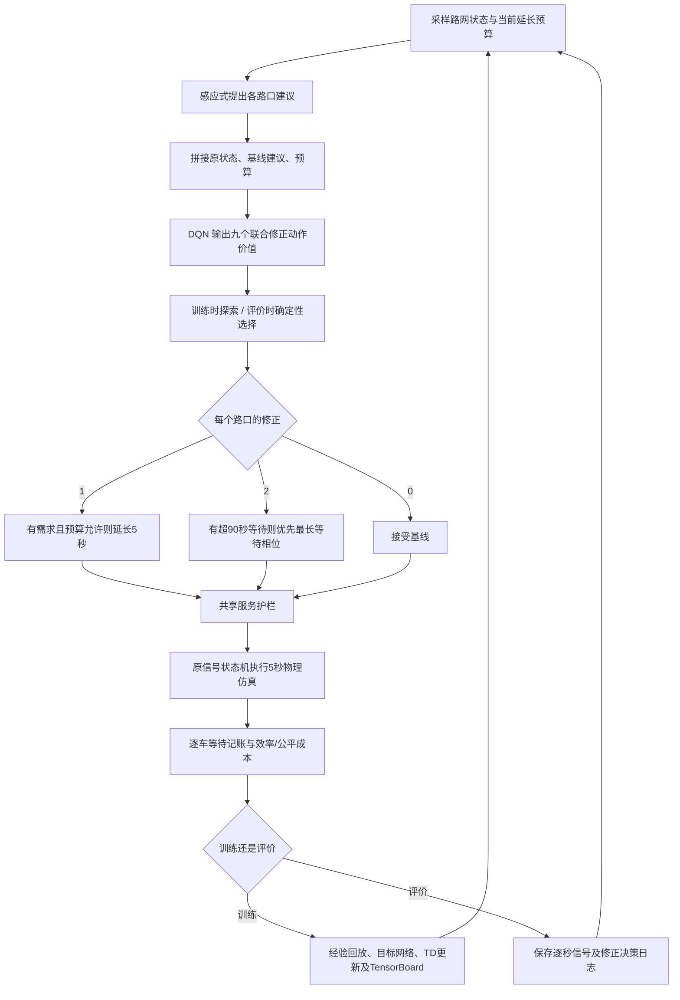

# 强基线辅助 DQN 实现

实现位于独立子包 `src/fair_signal/residual/`；不修改历史单路口或两路口核心。
`ResidualEnv` 继承两路口物理仿真与记账，新增 9 个联合修正动作和基线建议/预算观测。
它是单智能体、全网观测的混合控制，不是独立多智能体算法，也没有性能不退化保证。

## 动作、状态与边界

`action = 3 * correction_A + correction_B`，各 correction 为 0、1、2。
0 保持基线完整逻辑；1 仅在基线要求切换且当前相位仍有车时，继续当前相位 5 秒；
2 在存在累计停车等待达到 90 秒的车辆时，选择最大累计等待对应相位。
当前无适用修正则接受基线。黄灯/全红期间不改目标，未达到最小绿灯不提前切换。

延长预算按每段物理绿灯累计 10 秒。即便动作交替为延长/接受/延长，也不会刷新同一
绿灯的预算。预算随物理切换重置，只有真正改变共享护栏后请求的延长才扣预算。
延长不能超过原有最大绿灯；优先动作仍需遵守相同的黄灯/全红。
180 秒护栏可覆盖任何修正，仍只是提供服务机会，不保证实际等待或清空时间。

原 152 维状态保留，追加 A、B 各 4 维基线建议和 1 维预算使用比例，合计 162 维。
两个学习方法同观测、同网络、同探索与更新，只改公平成本权重。
固定每 5 秒一个 RL 步；继承原全网唯一车辆停车/入口积压成本及逐车累计超时成本。
SB3 DQN 的经验池保存的是修正动作；物理相位映射由环境负责，不替换经验池动作语义。



## 实验身份与质量

`residual_study.py` 将历史核心摘要、新控制模块和训练脚本组成独立源码摘要；
配置、历史 selection/study/validation 的摘要写入新 study。网络及验证路线逐文件复制并
校验，不重新生成或覆盖历史车流。完成模型仅在源码/配置/模型身份一致时复用。
中断的模型从头训练，不把缺失优化器/经验池的恢复当成无缝续训。

训练检查实际参数更新、在线/目标权重逐项重载一致、参数和 TensorBoard 标量有限。
`corrections.csv` 区分原始选择、基线建议、修正请求和护栏后的有效修正；
有效修正率分母为所有路口决策，包含受最小绿灯/过渡期约束而无法修正的决策。
有效修正代表请求不同，不直接等于改进，也不等于最终物理相位当秒已经切换。

`summarize_residual.py` 检查完整验证矩阵、逐秒约束、信号切换与预算重置、
停车积分与 TripInfo、决策计数与实际请求、45 条未修正传统回合精确复现历史指标。
统计先按每个模型的车流均值，再跨模型种子汇总；若方法存在删失，其全局性能留空。
验证数据是反复使用的开发集，只有预留测试可在设计冻结后用于最终盲测。

## 运行

```bash
bash scripts/run.sh python scripts/residual_study.py --workers 3
bash scripts/run.sh python scripts/summarize_residual.py
bash scripts/run.sh tensorboard --logdir outputs/residual-50k/models --host 127.0.0.1
bash scripts/run.sh python scripts/view_residual.py --method residual_dqn --delay 200
```

新脚本输出位于 `outputs/residual-50k/`，模型、原始轨迹及 TensorBoard 不提交 Git。
GUI 默认暂停并使用已验证的 XQuartz 显示地址；`--headless` 可精确核对冻结回放结果。
`--method actuated/always_extend/always_urgent/fair_residual_dqn` 可以在相同车流下比较。
