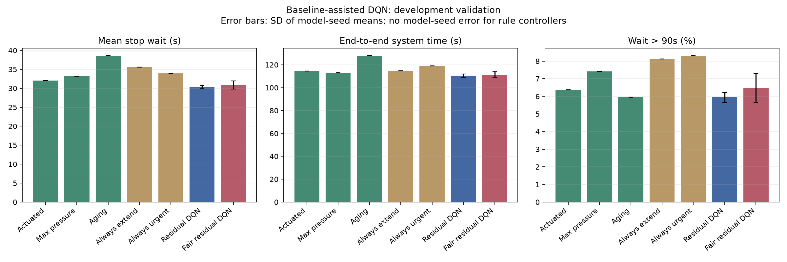
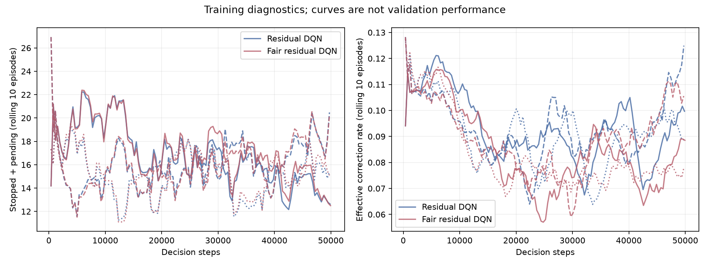

# 强基线辅助 DQN：开发验证结果

本轮在相同两路口、相同车流和共同信号约束下，**普通强基线辅助 DQN 取得了整体改善**。
相对感应式，平均停车等待降低 **5.41%**，含入口延迟完整行程缩短 **3.40%**，
平均停车次数降低 **13.71%**。165/165 个验证回合全部完成。

改善主要来自下游减速场景；稳定和潮汐场景的 P95 反而增加。
公平版本降低了超长等待的严重程度，但没有降低超90秒车辆比例，不构成全面优势。
这是反复使用开发车流得到的结果，不是最终盲测或普遍优于传统控制的证明。

## 本轮做了什么

固定方案见[预先方案](residual-plan.md)，控制定义及算法流程图见[实现说明](residual-implementation.md)。
基础为上一轮独立调参的感应式（minimum=10、hysteresis=1），每个路口允许：

1. 接受基线建议。
2. 当前相位有车且基线准备切换时，延长一个5秒周期，每段绿灯最多扣除10秒延长预算。
3. 当前有累计停车等待至少90秒的车辆时，优先其最长等待相位，否则接受基线。

这些修正仍需遵守原10/60秒最小/最大绿灯、3秒黄灯、1秒全红及180秒共享服务护栏。
延长预算只约束显式延长动作；超时优先动作仍受物理最大绿灯和共享护栏限制。
它是混合控制，没有“不劣于基线”或等待上界的理论保证。

两个学习方法使用完全相同的162维观测、9个联合修正动作、128×128 MLP和训练配置，
每个在线网络38537参数；公平版本仅追加lambda=1的原累计超时成本。
本轮没有加入到达预测、模仿预训练、Double DQN、额外修正惩罚或新参数扫描。

6个模型各50000步、各12250次梯度更新，合计300000步和73500次更新。
3个种子均为11/22/33，固定终点评价，没有挑选最好检查点。
774个自然结束的训练回合全部清空；预算到达时仍在途的末尾训练片段不计入该完成率。
Mac上3个CPU进程完成训练＋完整验证，墙钟 **877.73秒，约14.63分钟**；未新增依赖。

## 整体结果

学习方法各45回合（3模型种子×3场景×5车流），规则各15回合。
所有方法有相同共享护栏，原传统参数与网络/车流均保持一致。
先按每个模型的15条车流平均，再跨3个模型种子等权平均。
`±` 为模型种子均值的样本标准差，不是置信区间；传统方法没有模型种子标准差。
P95为回合P95的均值，停车等待不含插入延迟，完整行程包含插入延迟。

| 方法 | 完整回合 | 平均等待(s)↓ | P95(s)↓ | 超90秒比例↓ | 完整行程(s)↓ | 停车次数↓ |
| --- | --- | --- | --- | --- | --- | --- |
| 感应式 | 15/15 | 32.08 | 96.24 | 6.37% | 114.42 | 1.75 |
| Max-Pressure变体 | 15/15 | 33.21 | 102.48 | 7.42% | 113.09 | 1.51 |
| Aging | 15/15 | 38.64 | 95.62 | 5.94% | 128.05 | 2.37 |
| 总是请求延长 | 15/15 | 35.54 | 108.54 | 8.12% | 114.70 | **1.35** |
| 总是请求超时优先 | 15/15 | 33.96 | 92.53 | 8.31% | 119.05 | 1.93 |
| **强基线辅助DQN** | **45/45** | **30.35±0.43** | 92.54±3.03 | **5.94±0.28%** | **110.52±1.45** | 1.51±0.12 |
| 公平强基线辅助DQN | 45/45 | 30.87±1.07 | **91.51±0.35** | 6.47±0.83% | 111.47±2.40 | 1.54±0.13 |



普通修正DQN相对感应式：等待−5.41%、P95−3.85%、超90秒比例−0.44个百分点
（相对−6.83%）、完整行程−3.40%、停车次数−13.71%。
相对压力控制：等待−8.61%、完整行程−2.27%；停车次数差异仅−0.16%，不宜强调。

固定延长减少停车次数，却增加等待与超时；固定超时优先降低P95，却增加超时比例和行程。
学习修正的平均等待、完整行程和超90秒比例均好于这两条固定规则，支持“选择何时修正”
有价值；它不在所有指标上胜出，也没有覆盖调参最优规则、随机修正或所有传统控制。

上一轮本地Q的平均等待为40.32秒，本轮30.35秒；这是加入强先验、改变动作及观测后的
整套方案改善，不能全部归因于动作数从16减少到9，或声称纯DQN已经独立超过基线。

## 场景与种子：改善并不均匀

| 场景 | 感应式等待(s) | 普通修正DQN等待(s) | 感应式P95(s) | 普通修正DQN P95(s) |
| --- | --- | --- | --- | --- |
| 稳定车流 | 21.71 | 21.81 | 58.96 | 64.64 |
| 潮汐车流 | 26.12 | 25.25 | 66.80 | 71.43 |
| 下游临时减速 | 48.42 | **43.99** | 162.95 | **141.54** |

稳定场景平均等待略增0.10秒；稳定/潮汐场景的超90秒比例也分别由1.91%/2.44%
升至2.27%/2.72%。下游减速场景等待降低约9.14%，超90秒比例由14.77%降至12.82%。
所以整体收益主要来自瓶颈场景，不能表述为每个交通条件下均更优。

| 普通修正DQN训练种子 | 平均等待(s) | 完整行程(s) | 超90秒比例 | 有效修正率 |
| --- | --- | --- | --- | --- |
| 11 | 30.48 | 110.98 | 5.70% | 9.10% |
| 22 | 29.87 | 108.90 | 6.25% | 12.41% |
| 33 | 30.70 | 111.68 | 5.86% | 3.98% |

三个模型种子的全场景平均等待和完整行程都低于感应式，但干预风格存在差异。
仅三个训练种子，不声称统计显著；相同车流的成对差异见
[paired_differences.csv](results/residual-50k/paired_differences.csv)。

真实连续通过两个路口的车辆，普通修正DQN平均等待29.76秒、完整行程129.50秒、
停车1.876次；感应式分别为32.91秒、135.52秒、2.191次，压力控制为33.65秒、
132.98秒、1.902次。该结果支持通行改善，但没有邻路口信息消融，不能单独证明学会了协同。

## 学习修正与公平目标

普通修正DQN的有效修正率为回合等权平均 **8.50%**，公平版本为 **8.30%**。
分母为所有路口决策，包括过渡期与最小绿灯内的决策；不是可修正时机中的比例。
日志区分原始动作、修正请求和共享护栏后的有效请求，不把无效动作当成实际干预。

| 方法（各45回合） | 有效延长请求 | 有效超时优先请求 | 需求期有效修正 | 清空期有效修正 | 共享护栏接管 |
| --- | --- | --- | --- | --- | --- |
| 普通修正DQN | 2601 | 351 | 2860 | 92 | 102 |
| 公平修正DQN | 2280 | 609 | 2785 | 104 | 29 |

公平版本更常优先超时方向、较少依赖共享护栏，但平均等待比普通版本增加0.53秒，
超90秒比例增加0.535个百分点；P95仅从92.54降至91.51秒。

为解释这一取舍，在观察结果后补充了诊断指标：

`每车平均超时等待 = mean(max(全程累计停车等待 - 90, 0))`。

它按所有车辆平均，未超时车辆贡献零，与“只对超时车辆平均”不同。
从逐车TripInfo重建，并与逐秒公平成本积分独立核对。
感应式为3.73秒，普通修正DQN为2.95±0.52秒，公平版本为2.43±0.11秒，
后者比普通版本降低 **17.80%**。公平奖励直接惩罚超时部分的持续时间，
不直接最小化“是否曾跨过90秒”的车辆比例，两者可能呈现不同方向。
这一补充诊断不替换预定主指标，也不是新的选模标准。



训练图为10回合滑动均值；实线/虚线/点线对应种子11/22/33，混合车流下波动明显。
训练曲线及有限loss不构成收敛证明，优劣仍以上面的独立开发验证为准。

## 验证与局限

- 44项常规测试和2项新SUMO集成测试通过；后者包括接受基线精确复现、Gym接口、
  限额修正及实际物理/记账检查。其他历史SUMO集成测试本轮未重新执行。
- 短程联通：2模型各128步、各28次更新，21/21验证完成，9个传统回合精确复现。
  [联通产物](results/residual-smoke/quality.json)明确标记不作为性能证据；GUI通路也已实际运行。
- 正式165/165回合完成，未完成、未插入、异常移除、碰撞与传送均为零。
- 45个不修正传统回合逐项精确复现历史指标；审计165条逐秒信号轨迹和106926个完整物理区间。
- 验证延长预算与真实信号切换、所有修正计数、停车及公平成本积分、实际模型更新/重载，
  并读取6个模型的TensorBoard确认loss存在、所有记录标量有限。
- 新控制源码摘要为 `5883f233241bcae6f543ee6b9bf20a3b7418cb7ffab7af879dd04e1079d618f8`，
  训练核心提交为 `340f039`；历史单/两路口核心摘要均未改变，旧模型继续可回放。
- 固定首轮超参数与规则，未扫描或挑最好种子；验证集已用于多轮开发，仍可能存在适配偏差。
- 预留4001–4010测试未生成/评价；没有增加路网规模或提供实际道路部署证据。

当前更适合把**普通强基线辅助DQN**作为主展示策略，公平版本用于讨论公平目标的取舍。
下一步若继续研究，应优先在冻结设计后补充新的开发车流/需求强度，检验瓶颈收益是否稳定，
再决定是否使用预留测试；不凭本轮结果直接扩大路网或宣称DQN普遍胜出。

## 运行与观看

```bash
bash scripts/run.sh python scripts/residual_study.py --workers 3
bash scripts/run.sh python scripts/summarize_residual.py
bash scripts/run.sh tensorboard --logdir outputs/residual-50k/models --host 127.0.0.1
bash scripts/run.sh python scripts/view_residual.py --method residual_dqn \
  --scenario downstream_slowdown --seed 11 --traffic 2001 --delay 200
```

GUI默认暂停，Play开始、Stop暂停、Single Step逐秒推进；Delay越大越慢。
`--method actuated`可观看同车流基线，`fair_residual_dqn`观看公平版本。
正式模型已无界面精确回放核对；GUI显示通路使用独立联通模型验证。
完整模型/TensorBoard/原始轨迹留在`outputs/residual-50k/`，小型公开产物见
[质量记录](results/residual-50k/quality.json)、[完整汇总](results/residual-50k/summary.csv)。
