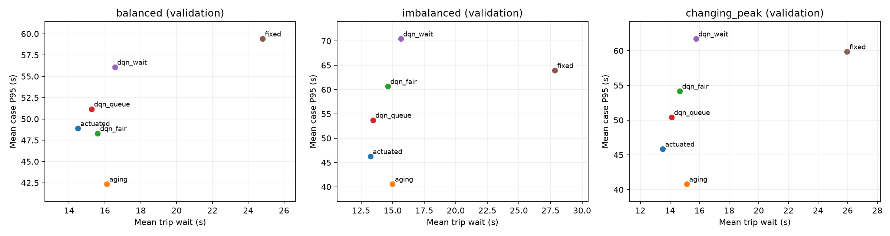
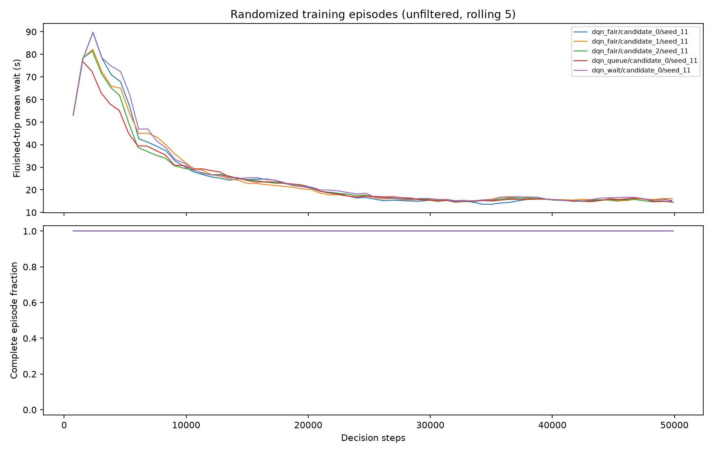

# 加长训练验证：运行方案与结果

## 预先固定的方案

本轮承接首轮 1 万步短跑，检查更长训练与更长车流窗口下的策略表现。
每个配置从头训练 50000 决策步，训练种子为 11；不是旧模型续训。
需求注入 3600 秒，允许最多 1800 秒清空，其余环境与算法参数保持原实现。
普通 DQN、等待状态 DQN、公平 DQN 的 lambda=0.1/0.3/1.0，共 5 个学习模型。
固定配时、队列感应式与等待老化基线保留原候选参数范围。

验证使用三个场景 × 五个独立车流种子 1001–1005，共 15 条路线；
14 个候选合计 210 回合。所有方法共用对应路线与 SUMO 随机种子。
选择目标仍为各回合等权的 `mean_wait + 0.5 * p95_wait`，
只允许全部回合完整、无碰撞与传送的候选参与选择。

本轮不执行 `--stage test`，不读取预留最终测试种子 3001–3010 的性能。
生成固定测试路线不等于评估；正式测试留到实验方案冻结后进行。
本轮结果用于开发与选参，不能作为无偏最终测试结果。

## 进入下一阶段的判断

先检查数值有限、模型确实更新、保存重载一致、所有车流保留、碰撞与传送为零。
再检查各候选完整率、未完成车辆和按场景的平均/P95 等待。
若公平 DQN 没有全部 15 回合完整的候选，先分析失败，不直接扩大训练矩阵。
若存在合格候选，结合相对普通 DQN 和 aging 的验证差异决定下一阶段预算。
单训练种子不足以证明稳定收益；不根据本轮验证结果宣称算法优于基线。

本轮同时改变训练预算、探索日程长度和需求窗口，不能将相对首轮的变化
全部归因于训练步数，也不能将随机训练回合曲线当作同车流的收敛证据。

## 运行与产物

```bash
bash scripts/run.sh fair-signal run --config configs/stability.yaml \
  --output outputs/stability-50k --stage train
bash scripts/run.sh fair-signal run --config configs/stability.yaml \
  --output outputs/stability-50k --stage tune
bash scripts/run.sh tensorboard --logdir outputs/stability-50k/models --host 127.0.0.1
```

模型、TensorBoard、逐回合指标与原始仿真数据保存在 `outputs/stability-50k/`，不上传 Git。
运行开始前提交配置和方案；完成后在本文记录实际结果，并提交小体积汇总与图表。

## 实际运行结果

运行日期：2026-10-11，MacBook Pro M3 Pro、18 GB 内存，CPU，未使用 GPU。
五个模型合计 250000 决策步、61250 次梯度更新，纯训练合计 843.08 秒（14.05 分钟）。
每个模型记录 67 个完整训练回合，合计 335 回合；训练结束时尚未完成的部分回合
不计入回合汇总。五个模型的参数均有限，实际更新检查和保存/重载动作检查通过。
每个模型都有 TensorBoard 事件文件。

验证共 15 条独立路线、17238 辆计划车辆，14 个候选复用这些路线。
全部 210/210 回合完整，未完成、未插入、碰撞和传送计数均为零。
所有候选在同一场景/车流种子下的路线 SHA-256 一致。
训练期间曾并行评估已完成模型和传统基线；各进程的 PyTorch 线程数均为 1，
耗时包含仿真重启和进程竞争，不能解释为机器最大吞吐。

验证仍选择固定阈值 [25,10,25,10]、感应式最小保持 10 秒、
aging 最小保持 10 秒且老化权重 0.1。公平权重选择如下，评分越低越好：

| 公平权重 | 完整回合 | mean_wait + 0.5×P95 |
| --- | ---: | ---: |
| 0.1 | 15/15 | 45.56 |
| 0.3 | 15/15 | 43.10 |
| 1.0（选中） | 15/15 | 42.15 |

以下均为三个场景、15 条验证车流等权的描述性均值。P95 是回合 P95 的平均，
不是合并车辆后的 P95；超时比例也是各回合比例的平均。

| 方法 | 平均等待 s | 平均回合 P95 s | 超 90 秒比例 | 平均队列 |
| --- | ---: | ---: | ---: | ---: |
| 固定配时 | 26.20 | 61.06 | 0.069% | 8.27 |
| 感应式 | 13.75 | 46.99 | 1.195% | 4.35 |
| 等待老化 aging | 15.41 | 41.24 | 0.000% | 4.86 |
| 普通 DQN | 14.27 | 51.76 | 1.297% | 4.49 |
| 等待状态 DQN | 15.98 | 62.74 | 2.101% | 5.05 |
| 公平 DQN，lambda=1.0 | 14.96 | 54.38 | 0.949% | 4.72 |



## 结果解释与奖励诊断

公平 DQN 相对普通 DQN：平均等待增加 0.69 秒，平均回合 P95 增加 2.62 秒，
超过 90 秒的比例降低 0.348 个百分点（约 26.8% 相对降幅）。
相对仅增强状态的 DQN，平均等待降低 1.02 秒、P95 降低 8.36 秒。
相对 aging，公平 DQN 的平均等待少 0.45 秒，但 P95 多 13.14 秒，且仍有超过 90 秒的车辆。
这些均为同一批车流的成对描述性差异，不是显著性或因果证明。

不同尾部指标给出不同方向的变化是可以同时发生的：90 秒位于本轮 P95 之外，
超过该阈值的车辆只占约 1%；惩罚极少量长等待车辆并不保证第 95 百分位下降。
因此本轮仅观察到公平 DQN 对“超 90 秒比例”的改善，不能概括成尾部等待全面改善。
仅增加状态也没有在本训练种子下带来更好的表现。

按固定的 3600 秒需求窗口统计，公平 DQN 的验证轨迹中有 4.81% 的仿真秒
至少一条车道的停车队首超过 90 秒，普通 DQN 为 13.98%。
这等价于公平奖励中的 H 项非零，但不是 H 的幅度、梯度贡献或车辆超时比例。
公平模型的队首等待超过观测尺度 180 秒的时间比例为 0.044%，
该观测分量偶尔会裁剪；普通 DQN 的相应轨迹诊断为 2.44%，但其基础状态不包含该分量。
本轮未保存训练时每步的分项奖励，不能从贪心验证轨迹推断训练时奖励是否充分。



训练回合的平均等待在后段大致平稳，但 epsilon 同时从 1 降至 0.05，车流也在变化。
这幅图不能区分学习改进、探索减少和随机车流的影响，也不能证明算法收敛。
本轮改变了需求窗口、训练预算与探索下降长度，与首轮短跑不是严格控制变量比较。
本轮验证没有出现首轮的清空失败，不能据此宣称所有车流下不存在饥饿。

## 阶段结论与下一步

本轮通过了清空与工程完整性检查，但没有得到公平 DQN 优于普通 DQN 或 aging
的全面证据。暂不直接投入完整 15 模型、30 万步权重扫描。
下一阶段优先补充训练种子 22/33 的同预算验证，固定本轮选出的 lambda=1.0，
保留三个 DQN 消融，检查当前差异是否主要来自初始化与训练随机性。
若进一步修改公平目标，应建立独立配置与结果目录，保留当前结果和原始奖励作为对照。
连续等待代价或覆盖全部停车车辆的惩罚可作为候选，不能与原奖励结果混为一组。
新增强制服务规则则属于独立约束干预，必须单独消融。

预留 3001–3010 最终测试种子没有执行性能评估，当前目录没有 test.csv 或测试评估输出。
正式测试应在算法、预算与选择规则冻结后执行；本页属于开发验证记录。

## 产物与来源

本机 `outputs/stability-50k/` 约 344 MB，包含五个模型、TensorBoard、训练回合与原始验证轨迹。
小体积结果导出在 [results/stability-50k](results/stability-50k/report.md)：
[方法汇总](results/stability-50k/method_summary.csv)、
[全部候选分场景汇总](results/stability-50k/candidate_summary.csv)、
[原始验证指标](results/stability-50k/validation.csv)、
[成对差异](results/stability-50k/paired_deltas.csv)、
[奖励触发诊断](results/stability-50k/reward_activation.csv)、
[训练记录](results/stability-50k/training.json)、
[质量检查](results/stability-50k/quality.json)、
[选择结果](results/stability-50k/selection.json)。失败回合 CSV 仅有表头，因为本轮没有失败回合。

运行前配置与方案提交为 `69c5f46`，启动时工作区干净，来源见
[provenance.json](results/stability-50k/provenance.json)。核心源码内容摘要为
`fe9c58361a5d6c2b15d26d56e99ae290dbd7d41c27f4e690e7a57b3cc9331b5e`。
本轮没有改变环境与训练核心源码，原有 GUI 模型兼容映射仍然有效。

复现汇总：

```bash
bash scripts/run.sh python scripts/summarize_validation.py --run outputs/stability-50k
# 用新模型演示已见过的开发种子；仍然是演示，不作为最终测试
bash scripts/watch.sh --run outputs/stability-50k
```
